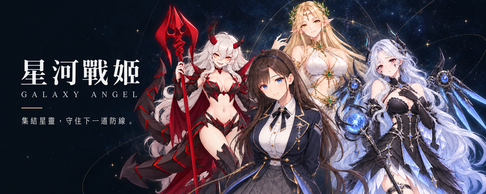
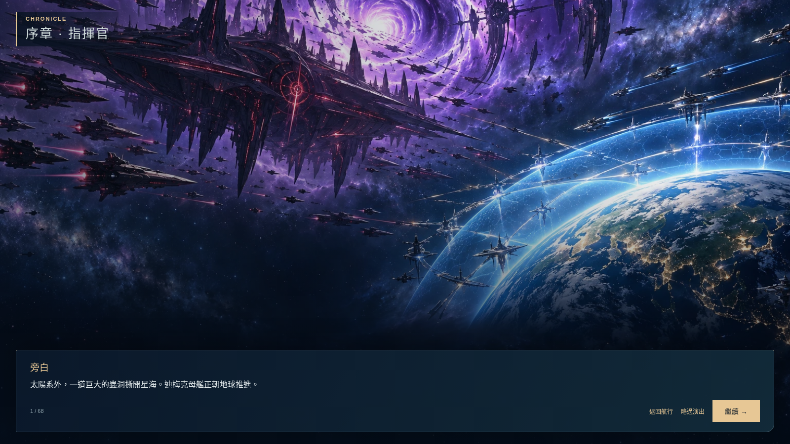
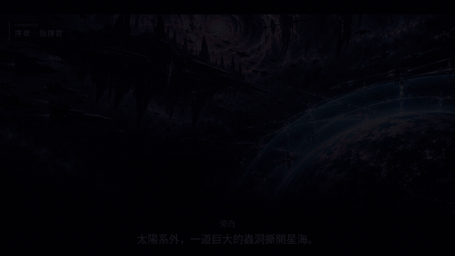
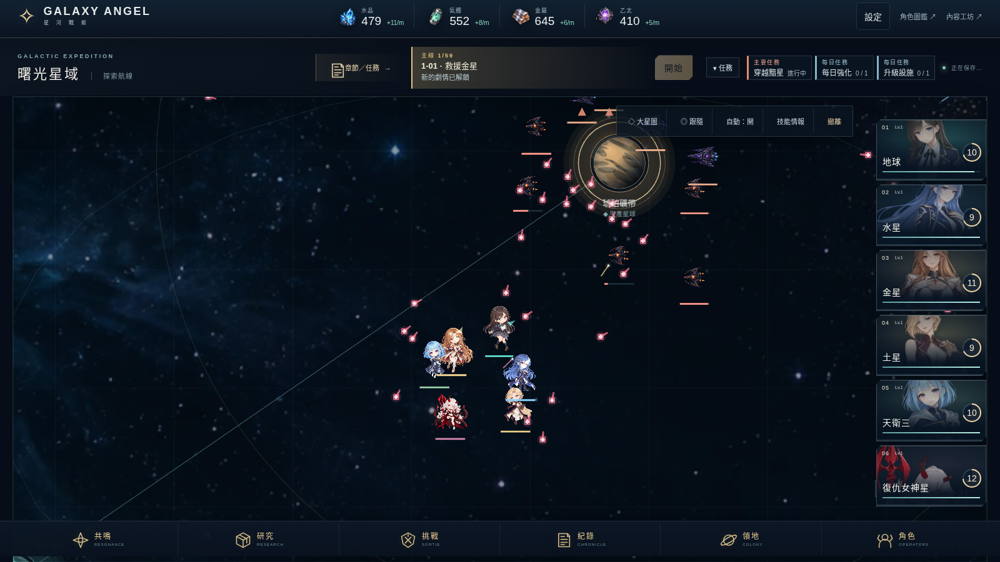
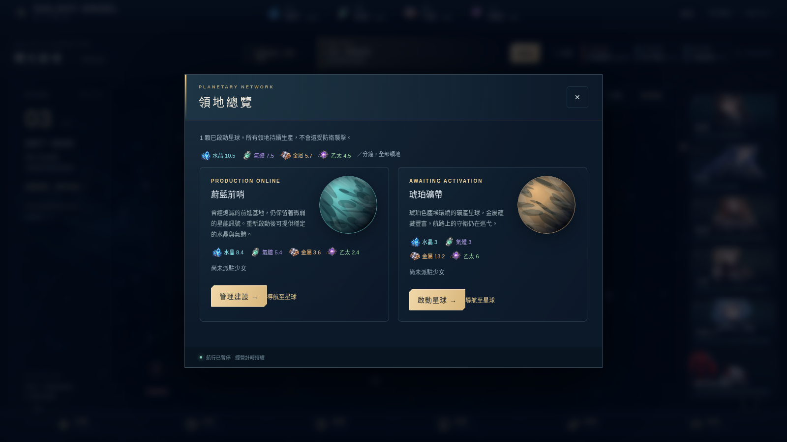
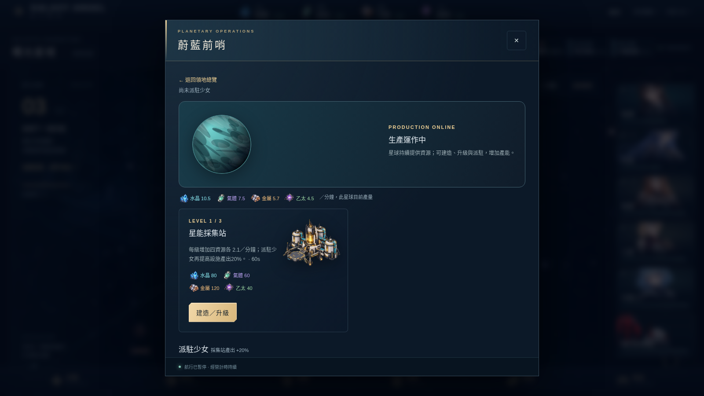
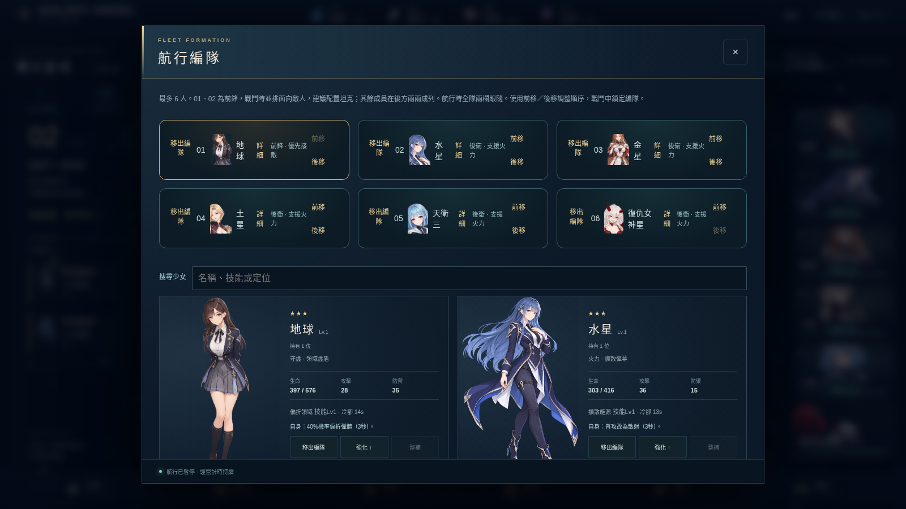
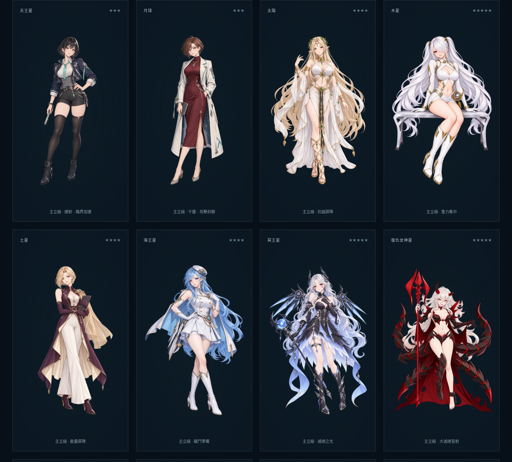
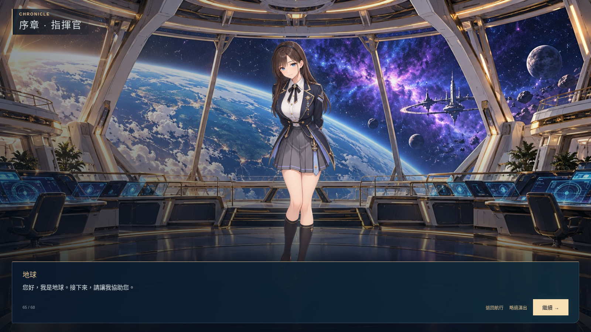
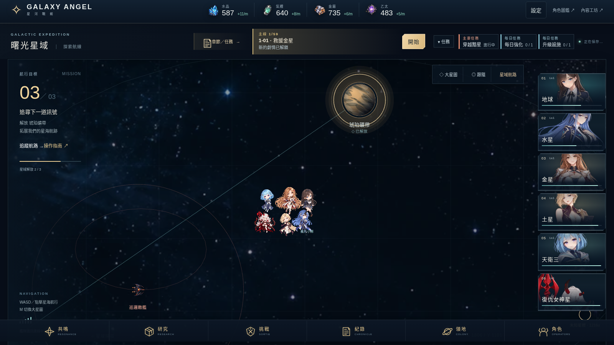

[線上遊玩](https://sces5504.github.io/20261020/) · [角色圖鑑](https://sces5504.github.io/20261020/gallery.html)



[](https://sces5504.github.io/20261020/) [](https://github.com/sces5504/20261020) [](https://sces5504.github.io/20261020/gallery.html)

# 星河戰姬 Galaxy Angel

一款結合星體少女收集、最多六人的即時小隊戰鬥與領地經營的單機網頁遊戲。在星圖上帶領少女航行，穿越巡邏敵艦與星球據點，在交戰中走位、施放技能，再把探索所得投入角色成長與星球建設。適合喜歡二次元角色、隊伍搭配與探索養成的玩家，開啟瀏覽器即可遊玩。

## 在下一次入侵之前

太陽系外，蟲洞撕開星海，迪梅克母艦正朝地球推進。守衛各星域的少女們——「星靈」——集結迎戰，卻逐漸失去抵抗的力量。天津四選中了身為靈魂造物者後裔的你，託付地球前來迎接。從這一刻起，你成為她們的指揮官。

從救援金星、尋找失蹤的太陽，到面對復仇女神星的敵意，旅程將逐步揭開星靈之間的牽絆。走出太陽系後，處女座的救援危機與黑洞威脅，又讓少女們在守住戰線與救回同伴之間產生衝突。

劇情透過角色對話、星域航行與遭遇戰推進。集結散落的星靈，重建後勤，準備迎接下一次入侵——也在並肩作戰的過程中，了解每位少女想要守護的事物。



## 劇情與實機預告

[](public/presentation/galaxy-angel-trailer.mp4)

**[▶ 觀看完整預告片（MP4）](public/presentation/galaxy-angel-trailer.mp4)** · **1 分 08 秒，有聲。** 從地球防衛戰與指揮官甦醒揭開序幕，接續星靈集結、六人出擊與星球建設。使用重新錄製的公開版實機畫面、圖鑑立繪與宣傳主視覺，搭配本片製作的合成配樂及轉場音效；無角色配音。

## 從探索到經營

### 01 · 接近星球，清除守軍

帶領 Q 版小隊在星域中航行，靠近敵方佔領的星球便會自動交戰。普通攻擊持續進行，玩家操控移動、閃躲射擊預警，並選擇施放護盾、擴散彈幕或砲台等技能；也能切換自動施放。清除全部守軍後，星球才會解放，開啟下一步經營。



### 02 · 啟動星球，建立資源來源

解放不等於開始生產。在領地總覽啟動星球後，水晶、氣體、金屬與乙太才會持續累積。領地總覽可查看每分鐘總產量，再進入各星球管理建設；四資源可用於建設、角色強化、共鳴與研究，探索與養成因此接成循環。



### 03 · 興建採集站，把據點變成後勤

投入四資源興建、升級星能採集站，等待工作完成後提高產量。這次實玩在蔚藍前哨完成一級採集站，四資源各增加 **2.1／分鐘**；也可派駐待命少女，提高採集站的設施產出。管理面板會暫停戰鬥，建設計時仍繼續，方便在兩場探索之間安排後勤。



### 04 · 收集少女，調整下一次出擊的隊伍

目前公開試玩版收錄 **75 位少女**，每隊最多編入 **6 人**。從地球、水星、金星，到太陽、冥王星與復仇女神星，可透過四資源共鳴、首次解放與任務逐步收集。共鳴配方影響候選角色，但不保證取得指定少女。

目前編隊的第 01、02 位為前鋒，戰鬥時並排面向敵人，其餘成員在後方兩兩成列；依各角色的護盾、屏障、火力與干擾技能安排前後排，再透過強化、整補、技能研究與重複角色同調培養隊伍。下圖為實玩取得的地球、水星、金星、土星、天衛三與復仇女神星六人編隊。



[角色圖鑑](https://sces5504.github.io/20261020/gallery.html)可瀏覽全部少女的主立繪與 Q 版。



<details>
<summary>查看劇情與星域航行畫面</summary>



地球將協助初次甦醒的指揮官，從艦橋展開下一段旅程。



透過大星圖規劃航路，逐步解放星球，再前往其他星域。

</details>

劇情、玩法與圖鑑畫面重新錄自公開試玩版 0.9.0（`28a20ac`）的獨立錄影存檔，包含已整合的重繪美術。預告片剪除等待時間，動態實機片段維持正常速度；劇情畫面經裁切並重新排版原句字幕，另穿插圖鑑定格與宣傳字卡。配樂及轉場音效僅用於預告片。

## 開始遊玩

1. 開啟[線上遊戲](https://sces5504.github.io/20261020/)，跟隨左上方主線指引開始航行。
2. 電腦使用 **WASD** 或點擊空白處移動，**M** 切換大星圖，**1–6** 施放對應角色技能；手機使用觸控搖桿移動、點擊角色施放技能。地圖支援滾輪或雙指縮放。
3. 解放星球後啟動生產，從領地、角色與共鳴入口安排建設、成長及隊伍。技能也能切換為自動施放。

進度自動保存在目前瀏覽器，**不會自動跨裝置同步**。更換裝置、瀏覽器或清除網站資料前，請先至「設定」匯出存檔，再於新裝置匯入。

目前提供開發中的試玩版本，內容、平衡與畫面會持續調整。

## 本機開發

使用 Node.js 版本見 [.node-version](.node-version)。在專案根目錄執行：

```sh
npm ci --ignore-scripts
npm run dev
```

`npm run build` 會產生網站建置輸出；進階工具與操作見[使用說明](docs/guide.md)，驗證方式見[測試說明](docs/testing.md)。內建內容工坊可在獨立測試進度中預覽調整，從遊戲的「內容工坊」入口進入；工坊入口碼僅供前端操作區隔。
