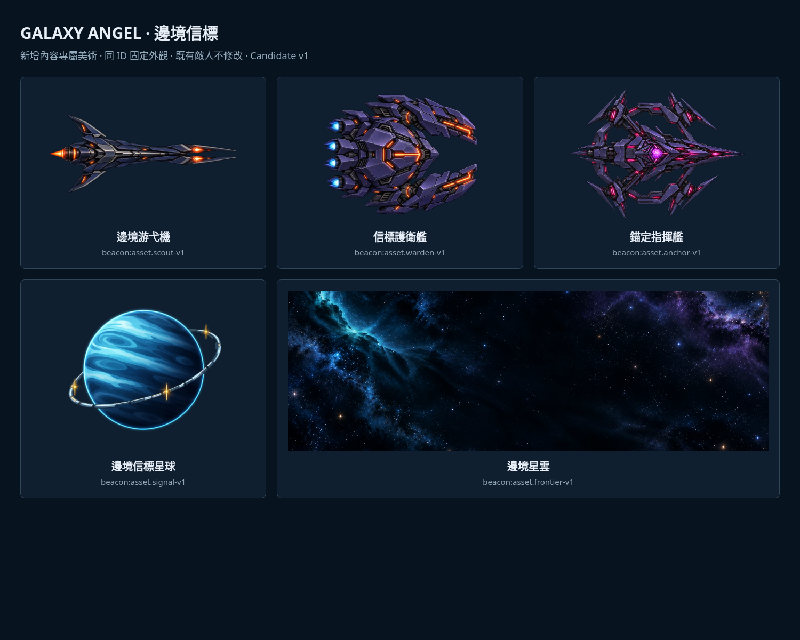

# 邊境信標專屬美術 v1

2026-10-21，使用者直接追加世界／敵人／Boss美術責任，要求依現有遊戲風格；不同敵種與Boss有不同長相，同一類保持既有架構與固定外觀。套用於 `beacon:package.frontier@0.2.0`，PR #8；不更換第一區同ID素材。



## 形象與引用

| 內容ID | AssetID | 輪廓識別／網頁尺寸 |
| --- | --- | --- |
| beacon:enemy.scout | beacon:asset.scout-v1 | 叉形長機首、單引擎、後置短翼；768×512 |
| beacon:enemy.warden | beacon:asset.warden-v1 | 寬身六角艙、雙鉗砲臂、四引擎；768×640 |
| beacon:enemy.anchor | beacon:asset.anchor-v1 | 尖塔艦體、斷開環架、四錨定支架；1024×759 |
| beacon:planet.signal | beacon:asset.signal-v1 | 藍色條帶星球、通訊環、三暖金信標；768×768 |
| m1:frontier-test背景，核心待綁 | beacon:asset.frontier-v1 | 左藍右紫、中央暗區、細金塵弧；1672×941 |

普通敵沿現有深海軍藍／紫黑金屬、俐落線條與橙紅能量槽；Boss紫核／洋紅能量與環架輪廓辨識。星球延用圖形化明暗分區及青藍大氣；背景延用低亮度藍紫星雲。沒有改既有角色、普通攻擊、子彈貼圖、警告或碰撞。

所有實例從自己的 `enemies[].sprite` 同一asset取得外觀：4架游弋同圖、2架護衛同圖、Boss獨立圖。沒有按instance／角色ID程式分支或隨機換皮，也沒有為既有 `m1:scout`、`m1:sentinel`、`m1:umbra` 換圖。最初過於近似既有偵察機的候選未採用；只交付目前不同輪廓的定稿候選。

## 素材與架構

- 自有目錄：`art/world/beacon/`。五張PNG為image_gen主檔，保留原位元組；五張WebP為Canvas等比縮放／quality0.9交付輸出，sprite保留alpha。`assets.json`包含主檔與輸出SHA256、參考檔SHA256、版本、用途、尺寸、sRGB、alpha／normal blend、pivot0.5/0.5、無atlas／無新動畫、生成提示版本與設計簡報、candidate狀態及預覽路徑。
- 創作參考均已開圖檢視：現有scout-ai、sentinel-ai、destroyer、haven、vein、cosmos；來源均是本專案既有圖。新圖不冒充REA原始素材；原作OBB仍缺。
- `content/extensions/frontier-beacon.json`新增五項AssetDef，src為現有schema支援的WebP data URI，hash對應WebP bytes；四個實體直接引用新ID。沒有新增loader／build複製規則或修改共用美術catalog，資料與圖可一起隨包匯出。
- 背景已在資產列表可預覽／替換。正式 `m1:frontier-test.background` 由核心整合者設定為 `beacon:asset.frontier-v1`，區域縮圖可設 `beacon:asset.signal-v1`；既有ID／routes保留。extension未覆寫區域。美術完整試玩快照明確使用此綁定作預覽，不當成正式包自動覆寫。
- 圖片呈現仍由核心限制sprite貼圖至多512、背景1800／低特效1024；沒有因主檔大小放大碰撞。素材candidate不自行標approved，不宣稱真機或商業品質已審閱。
- 五張WebP合計702812 bytes，完整含核心媒體的工坊ZIP22609435 bytes，低於既有25MiB壓縮／60MiB解壓上限。沒有新增依賴／付費服務。

## 重建與驗證

先有鎖檔依賴、tools中的Playwright與Chromium，以及既有正式 `npm run build`。只驗受影響畫面，執行：

```bash
source scripts/env.sh
node art/world/beacon/prepare.mjs
node --import tsx art/world/beacon/verify.mts
node --import tsx art/world/beacon/preview.mts
```

prepare保留PNG、檢查sprite透明角／可見不透明區，重建WebP、自己metadata與自己的extension素材引用；不寫基底或共用manifest。verify檢查五組hash、固定引用、三種敵圖相異、原有敵人／區域未變、完整ZIP匯出再匯入。preview使用工坊真實入口驗ZIP全部媒體hash／尺寸與解碼、四實體縮圖／詳情、Boss替換與undo、背景素材及390×844無水平溢出，並重建上方總覽。

戰鬥／預警預覽使用 [代表包驗證文件](../design/frontier-beacon-validation.md) 抽出的browser.ts：

```bash
source scripts/env.sh
BEACON_ART_PREVIEW=1 node --import tsx .artifacts/frontier-beacon/browser.ts
```

不設BEACON_ART_PREVIEW時驗真正assemble後的extension（仍用核心區域背景）；設為1驗美術完整快照。測試均使用隔離content:test／save:test，正式save:main不改。PNG／WebP及總覽提交，`.artifacts`中的測試存檔、完整ZIP與戰鬥截圖只作本機交付、可依腳本重建。

可匯入工坊的完整候選試玩包：`.artifacts/frontier-beacon/frontier-art-preview.zip`，**匯入會更換本機工坊草稿，先專案備份**。它不是extension JSON或正式發布，不包含正式玩家存檔。打開真實工坊→匯入ZIP→套用隔離測試；關卡前置與第一區進度仍走現有規則。

目前未新增動畫幀、死亡圖或Boss不同階段皮膚；既有移動／浮動／預警足以呈現本批已支援行為。後續同一種類沿用這張圖；新種類再新增自己的assetID，不覆寫本次ID製造無遷移的形象變動。
