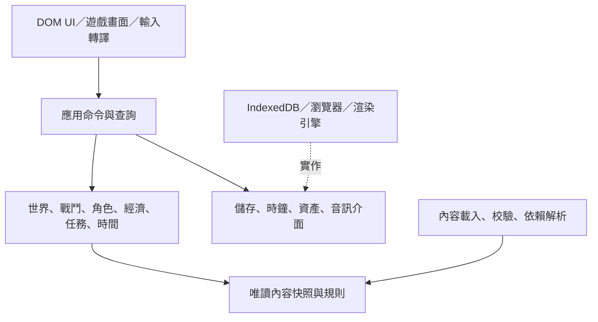

# 架構設計：讓內容、規則與呈現可以獨立修改

狀態：0.1 提案。依 [產品規格](../spec.md)；技術選擇尚待確認。本文件是實作契約草案，不是已有程式的描述。

## 1. 需要防止的耦合

1. 新角色必須去戰鬥程式新增 `if characterId == ...`。
2. 資源整併要同時手改六個面板、獎勵與存檔。
3. 刪星域後主線指向不存在的節點，舊檔無法載入。
4. 技能說明與實戰使用兩套數字，升級後不一致。
5. UI 直接扣資源，刷新或重複點擊時交易只做一半。
6. 分頁 FPS／計時器決定研究完成與離線收入。
7. 換渲染引擎必須重寫成長、存檔與經濟。

方向：單一程式庫內的模組化單體，純邏輯核心＋資料內容包＋呈現與平台介面。第一版不拆微服務、不加遊戲伺服器、不建無限制腳本 VM。架構需具擴充點，但不以過量抽象拖慢製作。

## 2. 建議技術方案與邊界

| 選項 | 適合之處 | 代價 | 建議 |
| --- | --- | --- | --- |
| TypeScript＋Phaser＋DOM UI＋靜態建置 | 2D 遊戲場景與輸入、粒子／音訊，易部署網頁 | 必須避免 Phaser 物件成為持久狀態真值 | 優先評估 |
| TypeScript＋PixiJS＋DOM UI | 精細渲染控制，能保持核心獨立 | 遊戲場景／輸入整合工作較多 | 若切片顯示有需要再選 |
| Godot Web | 編輯器與遊戲工作流完整 | Web 輸出、載入、瀏覽器整合與手機需另驗證 | 非本輪預設 |

這是方案比較，不是已鎖定版本或已驗證相容性。版本、lockfile、建置命令與測試基線在技術定案後記錄。DOM UI 是否使用 React／其他框架由實作評估，不能把框架狀態當遊戲資料庫。現有 `.template/project.json` 維持未初始化，不填虛假的遊戲命令。

## 3. 分層與依賴方向



核心不 import DOM、Phaser、React、IndexedDB 或網路客戶端。呈現讀查詢模型與顯示事件；不能直接改角色生命或錢包。內容載入完成後形成不可變的 `ContentSnapshot`；一場戰鬥使用同一快照，不途中熱換公式。

未來若增加雲存或其他平台，替換平台介面與衝突政策，不重寫領域規則。此界面不保證能零成本加即時多人；多人權威、同步與防作弊需新設計。

## 4. 模組責任與真值

| 模組 | 負責 | 持有的真值 | 不負責 |
| --- | --- | --- | --- |
| content | 定義、schema、引用、依賴、相容版本 | 唯讀快照 | 玩家進度 |
| campaign/world | 位置、發現、據點、領地、區域進度 | 世界持久狀態 | 畫面像素 |
| combat | 單位、AI、彈體、技能、命中與結果 | 遭遇內模擬狀態 | 直接寫 IndexedDB |
| roster | 持有角色、成長、生命與占用 | 角色實例與分配 | 召喚 RNG |
| economy | 資源餘額、容量、費用與獎勵 | 資源帳本 | 圖示與文字 |
| colony | 建設、派駐、生產、防衛 | 星球與建築實例 | 全域計時器 |
| progression | 研究、解鎖、融合條件 | 研究與解鎖進度 | UI 導航 |
| acquisition | 召喚資格、池、抽選與工作槽 | 召喚工作與結果 | 演出是否播完 |
| quest/story | 條件、故事旗標、獎勵領取 | 任務／故事進度 | 越權寫任意欄位 |
| jobs/time | 時間帳本、到期排序與進度區間 | 時間錨點與排程 | 任意領域獎勵公式 |
| save | 交易落盤、版本、備份、匯入 | 持久快照／修訂號 | 決定角色強度 |
| presentation | 畫面、音效、動畫、UI | 暫時展示狀態 | 遊戲進度 |

角色占用採唯一 assignment store，以實例 ID 記錄種類、對象與開始版本。戰鬥小隊與星球面板都查它，避免各持有不同的「忙碌」布林值。

## 5. 命令、查詢、事件與交易

命令表達意圖，帶 `commandId`、預期存檔 `revision` 與參數。例如：`SetDestination`、`SetPriorityTarget`、`CastSkill`、`AssignFormation`、`ActivatePlanet`、`StartConstruction`、`StartResearch`、`StartSummon`、`ClaimJob`、`UpgradeCharacter`、`ClaimQuest`。

每個命令：驗證語意 → 計算影響 → 檢查資源／容量／占用／前置 → 一次提交狀態、RNG、已處理 ID 與領域事件 → 回傳成功與新 revision，或具名失敗原因。不可先扣資源，再等待動畫完成才給角色。

查詢只產生唯讀模型，如 `GetPlanetSummary`、`PreviewUpgrade`、`GetAvailableRecipes`。所有可操作項目顯示同一份權限／條件結果，不由 UI 另猜。

領域事件描述已發生的事：`EnemyDefeated`、`PlanetActivated`、`JobCompleted`、`CharacterAcquired`、`QuestClaimed`。事件帶來源 ID、邏輯時間及唯一 ID，不夾 UI 元件。任務等衍生狀態在同一交易／同一穩定事件批次內更新；動畫與聲音是提交後觀察者，不能反向決定交易成敗。

失敗碼至少包含 `insufficient_resource`、`capacity_exceeded`、`assignment_conflict`、`requirement_unmet`、`stale_revision`、`content_unavailable`、`storage_failed`。前端轉成具體可理解文字。

### 建造交易範例

1. 使用者選星球、建築與工作者，查詢預覽成本／面積／電力。
2. `StartConstruction` 驗證星球 active、研究與可建條件、可用資源／面積／電力／人力。
3. 同一交易扣費、預留容量、鎖定工作者、建立 job；失敗全部不提交。
4. 到期命令將預留轉正式建築、更新產出、釋放工作者、發事件。
5. 領取／刷新再處理相同 job ID，不重複生成建築或獎勵。

## 6. 戰鬥模擬契約

固定模擬步長建議 1/60 秒，渲染獨立、可插值。低 FPS 不改模擬速度；單幀追趕有上限，超出時降低顯示幀率或暫停並告知，不能跳過傷害 tick。首次切片以實測決定是否 1/30 秒已足夠，不先以引擎預設當玩法規則。

每步穩定順序：輸入命令 → 移動／AI／目標 → 冷卻與狀態 → 生成攻擊 → 彈體移動與掃掠碰撞 → 排序命中 → 傷害／效果 → 死亡 → 勝負與事件。相同時間以穩定 entity ID／sequence 排序；快彈體不能只做幀末點重疊而穿透目標。

RNG 依用途分流：世界生成、召喚、戰鬥、掉落；持久抽選時連同結果提交。演出 RNG 不能消耗戰鬥亂數。固定 seed＋內容版本＋命令序列用於回歸，浮點差異下先承諾同建置同環境可重現，不宣稱跨所有瀏覽器 bit-exact。

邏輯碰撞半徑、空間分區、物件池、彈體資料與渲染 sprite 分開。GPU 粒子只顯示，不計命中。效果降級可減少火花與光暈，不減少有效攻擊與危險預警。

狀態效果定義疊層、刷新、互斥、持續與解除；同時死亡的獎勵與勝負順序要有測例。技能資料不是任意 JavaScript；新增效果原語需程式擴充與契約測試。

## 7. 時間與離線政策（提案）

| 時間 | 來源 | 背景／離線 |
| --- | --- | --- |
| 戰鬥 simulation time | 固定 tick、單調計時 | 第一版切背景即暫停，不在離線期間模擬戰鬥 |
| 經營 effective time | 本地時間差＋持久錨點 | 以有界差值補算，無伺服器權威 |
| 日曆 reset time | 規則指定時區及排程 | 本地判定；是否保留每日系統待決策 |

提案離線補算上限先設 24 小時，時鐘倒退取零且不倒退錨點；超額不生產，不積欠下次領。這些值皆放 ruleset、待使用者確認。防衛離線政策另設，不和生產補算默認綁定。

結算區間 `[lastSettled, effectiveNow)`，按 job 完工、停產／恢復、容量變更等邊界切段。先依該段有效產能累計，再處理邊界事件；同時事件以穩定排序結算，直到終點。收益與新錨點一次提交，中斷後重算同區間不能重領。

自然生產使用每種資源獨立的小數餘額／固定精度累計，避免頻繁刷新造成捨入損失。容量飽和時的餘額保留政策明定，不以幀數計收入。多個槽位工作同時完成後，衍生效果只觸發一次。

## 8. 存檔與恢復

IndexedDB 為提案主儲存；UI 偏好與非關鍵 cache 可另存。持久快照概念包含：

```text
SaveEnvelope
  schemaVersion / saveId / revision / createdAt / lastSettledAt
  gameBuild / rulesetId / rulesetVersion
  contentLock[{packId, version, hash}]
  rngStates / wallet / roster / assignments / formations
  world / colonies / research / jobs / quests / story / inventory
  claimReceipts / recentCommandIds / encounterCheckpoint
  orphanedContent / migrationHistory
```

不保存引擎物件、DOM、材質或函式；不把定義完整複製進每個角色。持有實例保存 ID、進度與個體差異；必要時保存 retired 定義的最小展示摘要供缺包恢復。

正常操作以 storage transaction 提交，UI 只有提交成功才顯示永久成功；quota／寫入失敗保留可匯出的待存草稿、標示尚未保存，不提升已提交 revision 或發出已提交領域事件。保留最近穩定備份，匯入先驗格式、引用、內容依賴與遷移預覽，覆蓋前備份。

多分頁採單寫入者租約＋revision 比對；其他頁唯讀或提示接管。即使瀏覽器沒有協調 API，儲存層仍以 revision 拒絕過期提交，不讓兩邊各自覆寫。

匯入／舊檔遷移：只沿明確版本鏈前進，未知較新 schema 不降級硬讀。以原檔副本執行遷移與驗證，成功後另存新檔；保留歷史與可回復原檔。

### 戰鬥中關閉的提案

進場保存隊伍／生命、遭遇 ID／seed、已提交入場費與參戰鎖定。遭遇中的掉落與進度先在 encounter scope 暫存，與結果一次提交後才成為持久獎勵並消除 checkpoint；開放世界連續遭遇則每場各自提交。中斷重開返回此遭遇的起始狀態，入場費不退；召喚與先前已提交獎勵不跟著戰鬥回滾。若需中途精確續打，後續另加完整模擬快照，不用「保存角色 HP」假裝完整續存。

## 9. 新增、停用、刪除與魔改

| 變更 | 可只改內容資料？ | 必須做的相容處理 |
| --- | --- | --- |
| 新角色／敵人／關卡／建築，沿用行為 | 是 | 參照、素材與數值校驗 |
| 調成本、權重、冷卻、獎勵 | 是 | 規則版本、對進行中工作是否生效 |
| 增減資源種類 | 是，若使用通用資源帳本 | 成本／池／獎勵重映射＋舊餘額遷移 |
| 增減編隊人數／槽位 | 是，受 UI 實測限制 | 超出成員回倉、保留角色、不靜默消失 |
| 全新技能機制 | 否 | 新增具名效果／行為、schema 與測試 |
| 全新持久系統 | 否 | 模組、命令、UI、存檔版本與遷移 |

內容生命周期：`active`（可取得）→ `retired`（不可新取得，既有保留）→ `removed`（需映射、隔離或退款）。作者不能只刪 JSON 期待所有存檔自然相容。

刪角色提案預設 retired；真刪時用 replacement mapping，或放入 orphaned 隔離區並移出編隊／工作。刪星域必須重定位玩家、處理進行中遭遇、任務與解鎖，不能生成不存在的導航目標。缺失的可選模組不默默永久丟棄：先備份，再預覽停用與退款方案。

資源四轉二的遷移必須指定映射、比例、捨入、上限與進行中費用；以單一 migration ID 只執行一次。舊金額的補償和新成本不需要數字相等，但需要可審閱的平衡理由。

## 10. 內容包載入與作者工作流

1. 作者編輯獨立內容包與素材索引。
2. schema 驗證、ID 唯一、引用、依賴循環、圖可達性、數值範圍、空召喚池、缺翻譯／素材檢查。
3. 工具輸出變更摘要與影響引用，列出遷移需求。
4. 啟動測試存檔，在 sandbox 預覽角色、彈幕、技能、建築與任務。
5. 通過目標驗收後產出有 hash 的 immutable bundle；下次進入安全點切換版本。

資料 mod 包只含 schema 容許資料與媒體引用，不執行任意腳本。程式 mod 是開發者維護的 build-time 擴充，需要重新建置；不能用「完全無 hardcode」承諾任何新玩法都不需程式。

第一版作者工具以 JSON＋校驗／報告為主；可視化編輯器、線上分享與模組商城不是已授權的必要前置。

## 11. 目錄提案

```text
src/
  domain/{combat,world,roster,economy,colony,progression,acquisition,quests,time}/
  application/{commands,queries,transactions}/
  content/{loader,schema,registry,validation}/
  platform/{storage,clock,assets,audio}/
  presentation/{game,ui,input}/
content/{core,baseline,simplified,mods}/
assets/{manifest,ui,portraits,sd,world,vfx,audio}/
tools/{content-check,content-diff,migration-preview}/
tests/{domain,content,migrations,integration,e2e}/
```

這是未建立的目標目錄；目前 repo 只有工具範本與規格。

## 12. 靜態部署與效能

GitHub Pages 是靜態託管；參考 [官方 Pages 說明](https://docs.github.com/en/pages/getting-started-with-github-pages/what-is-github-pages)。部署前依 [官方限制](https://docs.github.com/en/pages/getting-started-with-github-pages/github-pages-limits) 重查資產量、頻寬與用途，這裡不固定可能變動的服務配額。

產物包含入口、指紋程式、版本索引、內容與分包素材。支援 `/repo-name/` base path，不埋絕對根路徑。沿用專案 staging 規則只部署 `.artifacts/site`，不部署原始附件、APK、研究截圖或 repo 根目錄。

先載核心 UI、起始區域與起始隊伍；角色詳情、後續星域及語音按需載入。固定基準畫面量測 CPU／GPU／記憶體與載入，不把全部立繪一次塞進初始包。PWA 若確認，cache key 必須與 build／內容版本綁定，並處理更新中斷。

IndexedDB 的介面性質可參考 [MDN](https://developer.mozilla.org/en-US/docs/Web/API/IndexedDB_API)；它提供本地結構化儲存，不保證使用者不清除資料，因此匯出／備份是產品功能。

## 13. 架構驗收門檻

- 只加資料與素材即可加入使用既有原語的角色、敵人與星球，無特定角色 ID 分支。
- 以測試規則從四資源變二資源，UI、費用與獎勵跟隨；舊檔可預覽並只遷移一次。
- 拔掉可選資料包，系統能具體報引用與恢復方案，沒有 undefined crash。
- 同一命令／job／獎勵重送不重扣、不重發；儲存失敗不假稱成功。
- 戰鬥在無瀏覽器／無渲染器環境可執行核心驗證，換裝置不改命中與冷卻規則。
- 相同離線區間結算一次或分段結算，除已定義的容量／捨入政策外結果一致。
