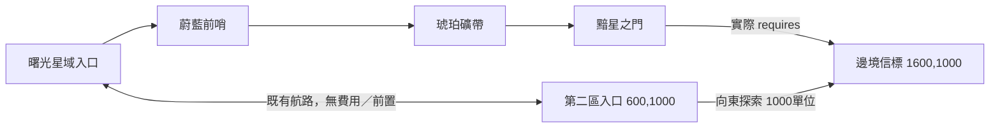

# 第二區代表包：邊境信標

2026-10-21。任務範圍：先盤點第一區缺口，再交一顆星球、一場單波遭遇，等待節奏回饋再擴量。依核心0.5.0；本文件數值全為本案新設計。

- 基底：`4610e8ab24360cdff39473befc5b37a0d1298c0f`，fetch 後與 origin/main 相同。
- 分支：`content/frontier-beacon`；包：`beacon:package.frontier@0.1.0`。
- 檔案：`content/extensions/frontier-beacon.json`，精確依賴 `m1:core@0.5.0`。
- 命名空間：`beacon:`；只新增三敵、一星球，不覆寫區域或修改共享程式。
- 延用 `m1:frontier-test`，不刪除或更換已有存檔所在區域。根 manifest 啟用由核心整合者處理。

## 第一區盤點

| 路徑／來源 | 查核結果 |
| --- | --- |
| 曙光入口→蔚藍前哨→琥珀礦帶→黯星之門 | 三星實際 requires 有序、無循環；守軍、產量、獎勵、圖片皆有定義 |
| 三顆星球清敵／啟動／建設／研究 | 既有完整戰役測試可通關並啟動三顆星球；34.2／44.3／61.4秒，單波 |
| 初始地球／水星／金星；礦帶火星；黯星月球；穿越黯星任務天王星 | 六角色皆可取得，不缺取得來源；角色引用未刪改 |
| 巡邏三隊 | 有敵群、290偵測圈、180橢圓路線、38相位速度、冷卻與既有收益；沒有補上離線戰鬥 |
| 曙光↔第二區 | 已有雙向無費用航路，入口在邊界內；不需修改基底 routes |

未發現需要新增第一區內容定義才能修復的斷鏈；不以加星球、加波次或重發獎勵冒充補完。已知共享呈現問題另交整合者：`src/presentation/ui.ts` 星球情報的一段普通字串含 `${v.resetSeconds}`，會顯示未插值的文字；本包不能修改該共享檔。前置未開放提示也只說「前一個據點」，跨區的具名前置提示可由核心改善。

## 地圖與解鎖



第二區沿用2800×2000、入口600/1000、discoveryRadius540、cosmos背景與bridge縮圖。入口距信標1000，不在360接敵範圍內。星球中心1600/1000、圖片半徑58；guardRadius180、engageRadius360、leashWarningRadius640、leashRadius780、resetSeconds3，整個交戰範圍可容納於區域內。座標、守軍與碰撞直接使用核心 `guardianPositions`／FleetMotion，沒有自行重寫位置公式。

`beacon:planet.signal.requires=["m1:umbra-gate"]` 是真實解鎖資料；未通第一區仍可到第二區觀察，但不能開戰。清敵不要求啟動前一星球。回程不鎖，戰中仍依核心禁止躍遷。原星域、工作、收藏與資源保留，重載保留第二區。

本批不新增巡邏，只有星球守軍一場遭遇。現有巡邏的前景時間、非阻斷勝利與面板暫停政策保持使用核心行為。沒有星門碰撞、離線補打、防衛、失守、修復或新貨幣。

## 敵群、隊伍與節奏

| 敵人 | 數量 | HP／防禦 | 攻擊／射擊間隔 | 追擊速度／側移上限 | 彈幕 |
| --- | ---: | --- | --- | --- | --- |
| 邊境游弋機 | 4 | 480／18 | 8／1.8秒 | 42／14 | aim |
| 信標護衛艦 | 2 | 820／20 | 11／2秒 | 25／14 | fan |
| 錨定指揮艦 | 1 | 1800／28 | 12／2.8秒 | 12／6 | fan；HP低於45%改ring |

普通orbitSpeed0.45，Boss0.25；射程600，普通彈速160，Boss145。總HP5360，低於第一區尾王守軍8076，定位為跨區後的恢復／補給節點，不是第二區難度終點。守軍一次到齊，waves空，不加增援。Boss僅使用核心既有 `phaseAt` 的「低血量改ring」，沒有召喚、無敵、衝刺、新預警或新勝負條件。

正常隊伍：地球前鋒、水星、金星，三人Lv3、零同調、滿血、無研究。參考總HP1671、未計防禦及命中原始普攻每秒139.2；**核心沒有統一戰力公式，這兩值只供比較，不新增戰力分數**。較弱隊：同配置Lv1，總HP1440、原始普攻每秒120。

| 隊伍 | 自動技能＋移動 | 僅普攻＋移動 | 存活 |
| --- | ---: | ---: | --- |
| 正常Lv3 | 40.5秒 | 50.3秒 | 三人皆存活 |
| 較弱Lv1 | 46.2秒 | 57.9秒 | 三人皆存活 |

以上為固定1/60步長、種子1／7／42、最近敵優先、沿目標左側240單位做90×130擺動的模擬；不是玩家手感核准。守軍固定出生，目前這三個種子結果相同，不能當成三種隨機地形。關閉技能也可殺死側移敵人，確認不是只有技能才能命中。實測程式與瀏覽器檢查見 [驗證重現](frontier-beacon-validation.md)。

## 收益預算

以下依水晶／氣體／金屬／乙太排序；全部引用既有四資源。

| 項目 | 水晶 | 氣體 | 金屬 | 乙太 |
| --- | ---: | ---: | ---: | ---: |
| 首勝獎勵 | 110 | 90 | 100 | 80 |
| 啟動成本 | 80 | 70 | 90 | 60 |
| 首勝扣啟動後餘額 | 30 | 20 | 10 | 20 |
| 每秒產量 | 0.06 | 0.10 | 0.08 | 0.08 |
| 每分鐘產量 | 3.6 | 6 | 4.8 | 4.8 |
| 啟動成本／本星產量，分鐘 | 22.22 | 11.67 | 18.75 | 12.5 |

四資源合計每分鐘19.2，對照前哨19.8、礦帶25.2、黯星32.4；不拉高被動產速取代任務。首次戰利品各資源可支付啟動，仍可選先養成。未啟動時不產出；沒錢時維持已解放並保留可重試狀態；原領地仍提供資源。

首次掉落 `m1:uranus`，為既有角色的確定重複取得來源，不是新角色或新增抽池。若尚未領第一區任務，可先取得首隻；若已持有可手動同調，滿階處理由核心現行既有四資源返還規則處理。星球首勝鎖由cleared＋receipt保護，重戰不再發資源或角色。沒有另加任務以重發同批收益。

## 素材引用與狀態

全部沿用已存在且可在工坊預覽／替換的資產，不新增媒體複製需求；每個hash已由content build與世界資產清單核驗。候選狀態不升格approved，不宣稱原作外觀復刻。

| 用途／資產 | SHA256 | 狀態 |
| --- | --- | --- |
| 星球 m1art:haven-v1 | f938c2546b79ac11db08e5d8a421493590dbaea3a74f254e9a9bc0957ea1b498 | candidate，共用外觀 |
| 游弋 m1art:scout-v1 | 48397e89c319a756f259268cab51a4fdd630d1c437e68e2e24c930d16fefe147 | candidate，共用外觀 |
| 護衛 m1art:sentinel-v1 | 378eb9a2164d36697dad51e7c46213beba27a565fcb16c6a389e5c4980671383 | candidate，共用外觀 |
| 指揮 m1art:destroyer-v1 | 60f8ac8866ce279c6acdad5d3310118ec9389fc2b2b22ecd0906d1c5ed892fb0 | candidate，共用外觀 |
| 既有區域 m1art:bridge-v1 | 764498afe3cd29eac398ae1f49e474b6e8fc5447eadb85dbda8d7cc26ec1aeab | candidate |
| 既有背景 m1art:cosmos-v1 | dfc9583ea50a21849f04f564ce0ed4886ec41ff0bb0554d01c438aaf2398d767 | candidate |

缺件狀態：執行需要的引用齊全；專屬信標星球／敵艦美術尚未製作，現在用共用候選圖。原作OBB仍缺，不臆造原作貼圖。

## 研究來源分界

- **已知**：研究包863檔、67表／37723列與370份bXML重建校驗成功；SQLite integrity及關聯驗證成功。局部 `stage_roster WHERE spawn_row BETWEEN 1 AND 3` 查得SE1→Wave96、Enemy_Scout01×3；SE2→Wave97、×7；SE3→Wave98、Scout×5＋Fighter×3。`SpawnPoint._row=1..3` 的 `f10=96..98`、座標76/25、146/70、167/-118；保留原生索引語義。native用途證據見研究包 `reports/stages.md`。
- **推論**：早期由單一偵察機群過渡到混合編隊，可作本案排敵節奏參考；不代表已知原版難度、解鎖路線或四資源收益。
- **新設計**：本包中文名稱、座標、requires、敵人數值、4＋2＋1守軍、Boss閾值、掉落與全部經濟預算。原作Wave的未知獎勵欄未映射成四資源；未把SE3直接當本關復刻。

查詢重現：先依研究START_HERE驗證並建SQLite，再執行：

```bash
python3 research/stella-maiden/tools/query.py --sql 'SELECT * FROM stage_roster WHERE spawn_row BETWEEN 1 AND 3' --limit 10
python3 research/stella-maiden/tools/query.py --sql 'SELECT _row,f01,f10,f11,f12 FROM SpawnPoint WHERE _row BETWEEN 1 AND 3' --limit 3
```

## 核心整合變更單與擴量門檻

1. 根manifest加入本包；不自動從檔名載入。啟用前把既有 `m1:frontier-test` 的「空白、沒有星球敵人獎勵」說明與航路的「測試」文案更新為內容實況，保留ID與既有雙向routes。此文案位於基底，交唯一核心整合者，extension不覆寫。
2. 第一區星球情報resetSeconds插值與具名跨區前置提示交共享UI修正；不在此包加入程式。
3. 正式啟用後舊草稿先備份，再從新版正式內容建立；不要覆蓋玩家工坊資料。刪包須先做領地與待處理遭遇修復預覽／備份，不能只從manifest移除。
4. 正式發布跑完整 `check release`，含test:polish第五組；本內容PR不自行部署。測試空域數量斷言在啟用後應由核心更新，不能把既有「第二區必為空」測試原封不動當作新包驗收。
5. 先由使用者試玩此代表關再擴星球／巡邏。桌機及390×844 Chromium證據不當成真機或商業品質驗收。
