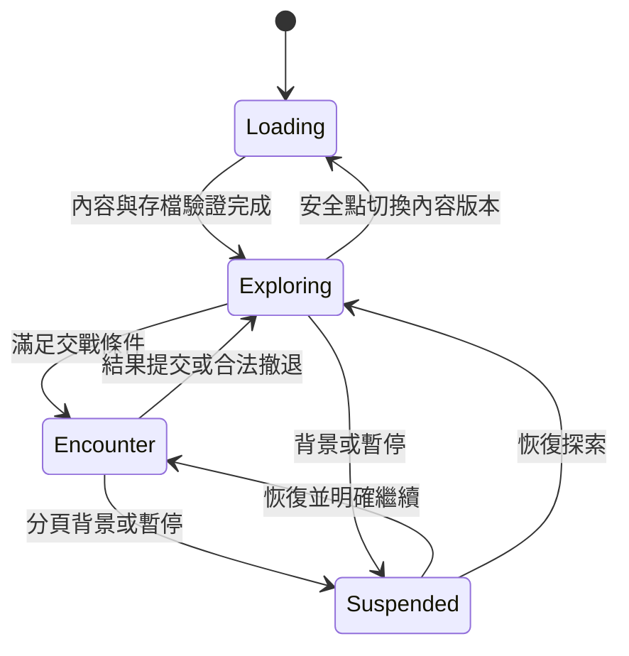

# 遊玩流程與跨系統狀態契約

> 目前生效：Galaxy Angel 0.3，先讀 [0.3契約](galaxy-angel-v3.md)、[0.2探索](exploration-v2.md)及[最新交接](../handoffs/galaxy-angel-v3-20261021.md)。本文件較早的防衛／訓練／舊分支／未有Q圖等敘述為歷史狀態，以新版明確契約與實際程式為準。

版本：0.5 決策與流程提案｜2026-10-20。依 [主規格](../spec.md)、[架構](architecture.md) 與 [驗收](production-plan.md)。這裡補「玩家實際怎麼玩」與系統交界；不是已查明的原作細則，也不是已製作的功能。

## 1. 一次完整遊玩的參考流程

已確認多數工作數分鐘內、在線防衛、失守停產可修復、離線不受襲；研究後已選保留四資源與操作簡化。下表是段落順序，不代表每段必須精確定時。

| 段落 | 玩家看見與操作 | 必須感受到的選擇 | 系統交付 |
| --- | --- | --- | --- |
| 回到遊戲 | 繼續存檔，查看經營結算與當前目標 | 接續探索或先調整隊伍 | 一份可略過摘要；不連續彈出十個領取視窗 |
| 整備 | 查看小隊與傷勢，更換／整補、選技能與站位 | 不同射程、速度、支援與傷害的組合 | 能比較前後差異並儲存隊伍預設 |
| 航行 | 在星圖設定目的地，看到隊伍、目標距離與任務 | 接近據點、解放星球或先做事件 | 航路與威脅可讀，不只是觀看計時 |
| 遭遇 | 指定敵人、走位、看預警與技能冷卻 | 集火、閃避、施放或撤退 | 命中與受擊有清楚回饋，能理解輸贏原因 |
| 收益 | 結算戰鬥與進度，看到可用的成長選項 | 繼續推進或投資發展 | 收益與首次進度一次保存；不強迫每項獨立確認 |
| 解放星球 | 清敵後查看啟動要求與用途，選擇投資 | 資源先用在星球、少女還是召喚 | 清敵與啟動分步，按下前看得到成本與結果 |
| 建設 | 查看土地、電力、人力，選建築或派駐 | 產能、容量、防衛之間取捨 | 前置／不足原因可解釋，失敗不清掉選擇 |
| 收集 | 調整／選用召喚配方，取得新少女 | 投入方向與隊伍需求 | 配方資訊、成本與槽位清楚；演出可略過 |
| 再挑戰 | 新技能、成長或編隊投入較強據點 | 實際感受到投資效果 | 新挑戰不是只有把敵人生命放大 |
| 結束 | 回安全狀態，確認保存及下次目標 | 自由離開，知道稍後回來會發生什麼 | 不要求準點登入；未保存時明確提示並可匯出 |

循環驗收重點：一輪至少出現「戰術選擇」與「發展選擇」，並能用下一場戰鬥驗證成長；不把成長全部放在看不到結果的長等待。

## 2. 新手引導的進度模型

引導步驟以功能與條件配置，不綁第幾個 UI 子節點或固定人物。每步有啟用條件、目標條件、提示 anchor、允許操作、跳過策略與完成旗標。

提案順序：相機與移動 → 指定敵人 → 手動技能 → 完成戰鬥 → 星球清敵／啟動 → 建造／派駐 → 配方召喚 → 成長／編隊 → 下一據點。

恢復規則：若目標早已達成，直接完成該步；若指定內容被改包移除，改由功能標籤尋找替代或跳過非必要引導。玩家跳過故事只影響已讀／演出，不能失去起始隊伍、必要功能或任務。

## 3. 遊戲與畫面狀態分離

這是邏輯狀態提案，不代表必須切換渲染場景。`Suspended` 保存進入前狀態與暫停原因，不以一個布林值推測恢復目標；圖中恢復兩條邊按此紀錄選一條。

面板狀態另行保存：開啟角色、研究或建築面板不改成「不在世界」。使用者已確認管理面板暫停戰鬥與襲擊、經營照常；所有巢狀管理面板關閉後才恢復。暫停不跳過結果提交，也不能讓敵人繼續攻擊、玩家卻無法操作。

## 4. 移動、鎖定與技能的細節提案

| 操作／情境 | 提案規則 | 尚需核對 |
| --- | --- | --- |
| 點空地 | 更新隊伍目的地，不把鏡頭拖曳算成移動 | 原作追擊與移動指令的優先級 |
| 點敵人 | 設優先目標並顯示標記 | 是否自動接近到各自射程 |
| 優先目標死亡／失效 | 依可見、範圍與穩定排序選替代，否則待命 | 是否保留先前目的地 |
| 角色射程不足 | 由移動政策決定接近，不能穿過敵方無限制追逐 | 近戰是否可離隊與最大追擊距離 |
| 技能有目標 | 按下先驗條件；需要地點時進入瞄準，可取消 | 原作個別技能目標類型 |
| 施放前目標消失 | 契約指定改找目標／取消，未成立不扣冷卻 | 施放中斷與已生成彈體政策 |
| 成員倒下 | 不再攻擊、不可施放；保留隊形資料，明確顯示 | 傷勢與治療具體代價 |
| 撤退 | 顯示條件、費用與結果，避免無提示離場 | 原作是否有範圍／冷卻／失敗條件 |

技能狀態：ready → aiming（若需要）→ casting → cooldown → ready；控制中斷與失效邊界由技能定義。通常在成功施放時支付費用並進冷卻；不是按鈕一按就扣，也不是動畫播完才扣。

命中目標與渲染圖像分離；游標／手指命中範圍可大於戰鬥碰撞半徑，讓手機好點，但不放大角色實際受擊範圍。重疊物件需有穩定優先順序或可切換的候選，不隨畫面陣列排序亂跳。

## 5. 角色占用與編隊契約

「存成隊伍預設」與「實際占用角色」分開：同一角色可以出現在多份預設中，但只有啟用隊伍／實際工作產生互斥占用。

| 狀態 | 可以做 | 不可同時做，提案 |
| --- | --- | --- |
| idle | 檢視、配點、進隊、派駐、治療、退役（未鎖定） | 無 |
| deployed | 控制、戰鬥、查看 | 派駐／治療／退役／當材料 |
| assigned | 查看、撤回派駐，依工作政策結算 | 出戰／治療／退役／當材料 |
| recovering | 查看、依政策取消 | 出戰／派駐／退役／當材料 |
| unavailable | 查看來源與恢復方案 | 所有會產生收益或消耗該實例的操作 |

鎖定是防消耗標記，不與 occupation 混成狀態；鎖定少女仍可正常出戰與派駐。HP 與傷勢也分開，不把「idle」當「滿血」。

戰鬥中不換隊，除非後續規則明確加入替補機制；安全點換隊一次驗證全部新舊占用。新增成員失敗時保留編輯草稿，不先把舊隊伍拆散。

管理面板中可查看參戰少女並預覽成長，具體變更在遭遇結束／安全點套用，或清楚拒絕當下操作；提案不增加複雜的隱藏排程。全域研究可正常完成，下場遭遇採新能力快照；本場顯示已生效值與下場預覽值，不混用。

## 6. 星球狀態轉移

| 原狀態 | 事件／條件 | 新狀態 | 原子結果／拒絕理由 |
| --- | --- | --- | --- |
| occupied | 守敵清除 | liberated | 保存清敵，不自動扣啟動費 |
| liberated | 玩家啟動且滿足費用／前置 | active | 扣費、所有權與基礎產能同時提交 |
| liberated | 守敵重生政策觸發 | occupied | 是否啟用由選定規則決定 |
| active | 攻擊開始 | contested | 保存攻擊 ID、預告／戰況，產出政策明示 |
| contested | 防衛成功 | active | 解除威脅並提交結果，避免重複成功獎勵 |
| contested | 防衛失敗 | disabled | 損失與停產按政策，建築／角色去向不可未知 |
| disabled | 恢復條件成立 | active | 修復成本、領地與產能同時提交 |

襲擊預告可使用獨立 `pendingAttack`，不必在攻擊真正開始前停產。使用者已確認失守停產可修復、離線不受襲；修復成本與額外設施損失尚未確認。切換規則時需處理正在預告／交戰的攻擊，不能留永久紅點。

## 7. 建造、研究與領取的交界

工作完成不一定要多按領取：提案建造／研究／治療自動完成效果；召喚保留角色揭曉演出，但結果先保存。介面可以「查看完成摘要」，不把完成效果綁在關閉提示上。

| 交界 | 契約 |
| --- | --- |
| 同時兩項施工 | 開工預留面積／電力／人力，不能各自看見同一剩餘量 |
| 完工與派駐撤回同時 | 以穩定事件順序判定，不能有建築完成卻角色仍被鎖 |
| 研究完成改建築上限 | 影響後續可操作條件；進行中工作依開工版本政策 |
| 開工後改模組成本 | 原成本與退款承諾保留，不用新價格重算舊退款 |
| 關面板／跳演出 | 只改呈現，不取消工作或重抽結果 |
| 缺素材／載入失敗 | 可重試演出，已提交交易保留 |
| 跨裝置匯入 | 以匯入檔為進度來源，不合併兩份相同 reward receipt 變雙倍收益 |

## 8. 資源簡化仍需保留的策略

無論最後選兩種或四種資源，都要驗證：

- 至少兩條有用途差異的發展投資路線，而非所有內容只比總金額。
- 召喚投入有可理解的候選影響，不是投入越多就全面更好。
- 建築產能、容量、防衛與少女成長存在階段性取捨。
- 常用資源可恢復，戰敗後不因無法整補而失去所有可玩內容。
- 不以刪去兩種資源、另加五種核心／代幣／碎片的方式重新堆高複雜度。

資源方向已確認保留四種；具體成本／收益與四槽名稱映射仍待完整用途／consumer查核。兩資源只是架構示意，非目前平衡。等待方向已確認數分鐘內，初始範圍提案見下節。

## 9. UI 模式與恢復狀態

主畫面最多一個主要工作面板，浮層堆疊有單一管理者。返回依序關閉確認／瞄準／面板，不直接離開遊戲。是否攔截瀏覽器返回以實作與平台限制驗證，畫面始終提供可見返回按鈕。

錯誤保留玩家可修復的上下文：資源不足保留配方；派駐衝突顯示目前工作並可導航；容量不足顯示需求差額；版本不相容提供匯出與回復。具名錯誤不得直接顯示堆疊追蹤給玩家。

背景恢復先顯示「已暫停／經營結算」再讓玩家主動繼續戰鬥，避免切回就被彈幕擊中。若管理面板仍開啟，即使按繼續也維持管理暫停；待最後一個原因解除才重啟模擬。

## 10. 跨系統驗收補充

| ID | 情境 | 可驗收結果 |
| --- | --- | --- |
| F-01 | 同角色出現在三份隊伍預設 | 只有實際啟用者占用；不複製持有實例 |
| F-02 | 開啟面板時有敵方彈幕 | 按確定暫停政策處理，不發生無法操控卻持續受傷 |
| F-03 | 召喚完成時圖像載入失敗 | 可重試展示，不重抽或再扣費 |
| F-04 | 解放但沒錢啟動星球 | 狀態、缺額與資源取得路徑清楚，仍可繼續遊玩 |
| F-05 | 舊檔從中途引導恢復／移除指定角色 | 由條件與功能標籤恢復，不因缺 ID 卡死 |
| F-06 | 背景再回到戰鬥 | 暫停提示與明確繼續，沒有恢復瞬間偷走模擬時間 |
| F-07 | 角色同時被退役與派駐命令引用 | revision／占用保護，只成功一個，沒有失效角色引用 |
| F-08 | 施工完成同時結算離線收益 | 只將新產能套在完成後區間，工作者正確釋放 |

## 11. 等待節奏提案：能邊玩邊完成

使用者已確認方向：多數建造、研究、治療數分鐘內，一次遊玩看得到成長。下列數字是初期平衡候選，還不是使用者逐項確認的時間表，也不是原作數據。

| 工作 | 初期候選範圍 | 節奏目的 |
| --- | --- | --- |
| 首座引導建築 | 10–30 秒 | 立即理解工作與完成回饋，不先等幾分鐘 |
| 一般建造／升級 | 30–120 秒 | 打一到數場後可回來看到結果 |
| 早期研究 | 60–180 秒 | 同次遊玩中取得新選擇並測試 |
| 治療／整補 | 10–60 秒 | 不因一次失誤長時間失去主力 |
| 召喚揭曉等待 | 10–60 秒 | 仍有期待，未強制依原作長工時；是否同樣縮短待定 |

建議教學／第一可玩循環至少完成一次研究或建造，並用結果再打一場；若玩家只能離線等、無事可做，則節奏未達標。不能用材料價格放大十倍補償縮時，重新創造更長的刷取等待。

工作可重疊進行，前提是槽位／角色／資源允許；第一版不以廣告或付費加速作為正常節奏的一部分。後期少量長工作若有必要，需有可替代活動與可預期結果，另列內容審閱。

## 12. 在線防衛與離線邊界

**已確認**：保留在線防衛；失守停產可修復；離線不受襲。

| 情境 | 規則 |
| --- | --- |
| 尚未觸發襲擊就關閉／隱藏遊戲 | 不產生新襲擊、不累積下次登入補發 |
| 預告或交戰中關閉／隱藏 | 保存剩餘有效時間與狀態，離線凍結；回來先提示再繼續 |
| 離線前已失守 | 失守維持停產；返回後可修復，不自動變回正常星球 |
| 重新開啟／匯入存檔 | 依持久狀態恢復，不因壁鐘經過直接判輸 |
| 持續在線但停在管理面板 | 已確認暫停戰鬥與襲擊，經營照常；不補跑襲擊進度 |

提案：已建設施與少女保留，修復支出與時間是明示成本；攻擊前有足夠預警、導航與威脅資訊；初期限制同時襲擊數與恢復後緩衝，避免管理大量星球成為打地鼠。具體攻擊頻率、預告秒數、修復費用與設施是否受損，尚待確認／試玩。

補充驗收：掛離線一週不生成失守；在倒數中關閉、重開十次不增加／倒退攻擊進度；停產星球離線收益為零；在線失守修復後從正確時間點恢復產出。

## 13. 存檔與跨裝置的玩家流程

使用者已確認本機自動保存＋匯出／匯入，不要求第一版自動雲同步。

匯出：設定／存檔 → 查看目前進度與保存狀態 → 產生檔案 → 用作業系統下載／分享功能保存。iOS／Android 的檔案與分享能力需真機驗證，不能只靠桌機下載通過。

匯入：選檔 → 格式／內容／遷移校驗 → 預覽角色、星域、保存時間及可能差異 → 備份本機現檔 → 使用該份進度 → 安全載入。取消或校驗失敗不改原檔；遷移後仍保留原始匯入檔的回復路徑。

若電腦手機各玩出不同進度，讓玩家選要保留哪份，不自動相加資源／角色。UI 明示本機保存範圍與備份方式；不能以「支援手機電腦」暗示進度會自動跟隨。

## 14. 手動／自動技能契約

已確認普通攻擊自動、技能預設手動且可切自動，移動與閃躲由玩家控制。

- UI 使用明確的「自動技能」開關與狀態，不暗中開啟追敵或閃躲。首次預設關閉；是否記住玩家選擇屬設定實作細節。
- 自動技能走同一 CastSkill 驗證與效果入口，不能有第二套免冷卻／免費用邏輯；暫停期間不施放或累積施放。
- 自動技能只有有效目標與前置滿足才嘗試，沒有目標不耗費。需要選點／位移的技能具 autoEligibility 與目標策略；提案位移／重新站位技能預設維持手動，避免自動改走位。
- 同 tick 的手動技能命令優先於自動決策；同角色不重複施放。同時多技能依穩定優先序，不依 UI frame rate。
- 自動技能不保證最佳策略；玩家仍可隨時關閉、手動施放與改優先目標。失效／冷卻原因能看懂。

驗收：開自動技能後站著不會自動走位閃彈；關閉後只有普通攻擊繼續；暫停三分鐘不累積爆發；目標消失不空扣技能；手動／自動同時輸入只施放一次。

## 15. 橫向桌機與直式手機

已確認桌機使用橫向戰場與介面，保留原作美術；手機以直式為主，不將桌機限制在中央手機比例。

桌機提案：星圖／戰場為可用寬度的主底層，資源與任務沿上／左側排列，小隊及技能靠下方，管理面板為可收合的側向工作區。開管理面板依既定政策暫停戰鬥，面板不必把戰場擠到看不懂。具體面板位置先以代表畫面審閱，不用影片兩側海報直接當 UI。

手機提案：縮短常駐任務摘要與資源列，保留底部技能可及性；完整管理採全頁／高覆蓋面板，雙指縮放和回隊按鈕明確。預警、方向標與首領關鍵資訊優先於裝飾。

相機比例不同不改世界座標、敵人射程、彈速或獎勵；可以看到不同範圍。畫外危險需方位、預告與足夠回應機會；不得在手機畫面邊緣瞬間刷出無法反應的命中。換方向時保留隊伍位置與玩家目標，不重開戰鬥。

驗收以兩種布局各自可讀、可操作為準；不再要求兩種螢幕必須顯示相同世界矩形。單機的視野差異需在試玩記錄中評估，不加入自動閃躲補償。

## 16. 四資源的配方預設、一鍵投入與批次管理

使用者已確認這三類操作簡化，保留四資源與原作配方策略。以下具體流程為可審閱的實作契約提案，不表示已核定全部按鈕與數值。

### 配方預設與一鍵投入

預設包含穩定presetId、名稱、完整四資源量、普通／高級模式、來源版本及可選來源配方row。玩家預設與原作來源配方分開；同一預設不保證抽到單一人物。

流程：選預設 → 一鍵填入四項 → 顯示成本、可用量／缺額、模式及條件 → 可手動調整 → 確認啟動。填入與預覽不扣資源、不占槽、不抽結果；真正開工才原子提交。

資源不足不自動縮放比例、不拿其他資源補缺、不偷改普通／高級模式。顯示具體差額與可導航的取得方式。模式不相容時保留原預設並解釋，不能靜默轉換。

匯入後找不到資源ID、模式或來源版本時，預設標示待修復，不能直接執行。研究四槽名稱映射未確認前，來源保持slot1..4，不能用猜的資源名生成正式預設。

### 批次開工

玩家明確選擇可用槽位／次數與每項配方；批次是有限的這一次工作，不是連續自動刷抽。預覽列出完整總成本、所需核心、容量預留、可用槽位與前置。

提案批次開工採全部成功或全部不開始：重新驗證revision與全部條件，在同一交易扣完整費用、預留容量、保存各次抽選與job。任一項不足就保留編輯與差額，玩家可自行減少次數；不偷偷開一部分。batchId與各jobId具去重保護，重送不多扣或重抽。

### 完成與批次管理

建造、研究、治療依既定規則自動完成效果，可在摘要批次查看，不多加必須領取的步驟。召喚批次領取／查看支援略過重複演出，但每個job的結果先前已保存，略過不重抽。

批次領取只處理合法且尚未領取的項目；已領取者跳過。容量／獎勵政策造成不能處理的項目維持未領狀態，摘要列成功、略過、待處理及原因。每個項目用既有receipt交易；可恢復的部分完成不再從頭發獎。

星球列表可篩選／排序滿倉、停產、工作完成與空閒，不因「批次管理」自動替玩家拆建、派駐或挪用資源。批次查看與批次花費分開；消耗性操作顯示總影響後確認。

### 驗收

| ID | 情境 | 預期 |
| --- | --- | --- |
| R-01 | 套用預設且某項不足 | 四項量值不變、缺額清楚、未扣費 |
| R-02 | 相同預設與手動輸入同四項 | 進入相同候選／距離策略，預設不額外加成 |
| R-03 | 確認前資源／槽位被其他工作占用 | 交易重新驗證，整批不開工且保留選擇 |
| R-04 | 雙擊批次開工／刷新重送 | 一個batch、多個指定job，各扣費／抽結果一次 |
| R-05 | 批次領取途中中斷再恢復 | 已領的不重發，未領的仍可處理 |
| R-06 | 略過全部取得演出 | 收到原已保存結果，無重抽／漏發 |
| R-07 | 預設跨版本缺資源／模式 | 標待修復，不猜映射或自動改配方 |
