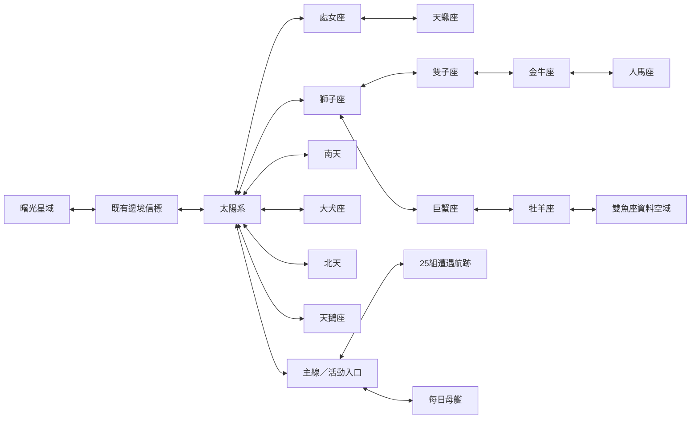

# 原作世界／敵群內容包

本輪使用者授權完整地圖、敵人／Boss 與美術，包含活動與每日 Boss；必要共用欄位與流程亦由本輪補齊，為唯一核心整合者分工的單次例外。原文與起點見 [交接](../handoffs/original-world-20261022.md)。命名空間 `original:`；核心由 0.6.0 升至 0.7.0，保留既有 M1／信標、六張原始立繪與存檔。

## 資料、推定與新設計

唯讀 SQLite 來源：`research/stella-maiden/generated/stella_research.sqlite`。`tools/world/inventory.py` 抽出局部表；`tools/world/compile.py` 確定性編譯自己的 extension，`coverage.json` 逐列對應與排除原因。沒有取得 OBB 或執行原 APK；「來源已抽出」不等於原版全機制已驗證。

| 項目 | 已知 | 本作適配／仍有缺口 |
| --- | --- | --- |
| 星域 | 14 Galaxy 定義、51 筆有向星門 | 補明示安全回程；雙魚座無原始節點／星門，以可返回資料空域保留，不發明敵群 |
| 星球 | 85 PID、座標、四資源啟動費、產量權重 | PID→守軍 Wave 為關聯推定；每秒產量為來源權重 ÷600；不是原版每秒公式 |
| 據點 | SpawnPoint.f10→Wave._row；七組 CID／count | XY 每來源單位換10世界單位、Y反向；無守軍基地使用既有付費整補工作 |
| 敵人 | 65 CID、62個來源 model 外觀識別、Skill 引用 | 普攻形態、移動單位換算與側移限制為框架適配；不假稱完整 Shot／AI 原生控制器已重建 |
| 成長 | ATK／DEF／HP 的原生整數截斷公式 | 攻擊／防禦仍走現有防禦策略與技能引擎；普通單位／Boss近距側移上限14／6 |
| 太陽系 | Earth→Moon→Mercury→Mars→Venus→Pluto→Uranus→Neptune→Saturn→Jupiter→Nemesis→Sun | `requiresActive` 與隱藏資料控制實際解鎖；其他星域星球不杜撰固定序列 |
| 每日 Boss | 七日表、四母艦 CID、BossLimitSec180、BossChance3 | KST換日可配置；四模板各為獨立傷害挑戰，共享每日3次進場，每節點每日只領一次；此拆分及獎勵比例是本作定案，非已還原原版部件流程 |
| 主線／活動 | 所有非取消、非debug Wave 的敵群與等級 | 事件VM／任務觸發未完整還原，以獨立遭遇航跡、串接先後與返回入口承載；不冒稱原作劇情腳本已全部復原 |

公開交叉來源：[原作總覽](https://m.namu.moe/w/스텔라%20메이든)、[太陽系](https://m.namu.moe/w/태양계(스텔라%20메이든))、[處女座](https://m.namu.moe/w/처녀자리(스텔라%20메이든))。太陽系／處女座的 Kiraba／Mitsuba 突進與扇形射擊以既有 dash／fan 原語實現，保留 CID 原主動增益；距離／預警／節奏屬適配。其餘 Boss 不用任意血量閾值假造階段，`phaseAt=0`，使用來源主動技能。

940 場非空 Wave 中，671 場可玩、269 場排除（205防衛、50數字訓練、14除錯／教學fixture）。754個世界節點包含85星球、據點／基地、事件重演與28每日排程節點。48個新增區域為14一般、7高難、25事件航跡、事件入口、每日母艦。

## 地圖與出入口

每個一般星域10000×10000，來源原點映射(5000,5000)；太陽系起點(5970,5530)在Earth。來源的星球／據點座標保留相對幾何，視覺大小不改碰撞，navigation仍是守軍／巡邏位置唯一算法。守軍單波生成，越界重置1400、警告1200；沒有追加三波。

圖為主要連通骨架，完整51筆來源航路及回程以資料為準。前往較高序星域需清完出發區的全部一般據點；返回低序區無此鎖。前7一般區完成據點後可進對應高難，另有無條件回程。事件航跡首節點無先決，後續依自己的前節點首勝；路線與節點都有真實資料。舊 `m1:frontier-test` 保留，根manifest的 `regionRoutes` 僅由本輪特殊授權整合，extension不覆寫基底。

新玩家可從設定選擇「開始太陽系航跡（先備份）」；原有航跡可沿邊境航路進入。原M1四星球首輪仍有獨立回歸驗證。

## 難度與收益預算

三人編隊沿用現架構。一般區來源等級從1至128，高難也保留Wave來源等級；角色上限120以支援完整後期，後期須強化、同調與研究。較弱隊伍不是保證通關；需能實際命中、避彈、撤離及整補。固定seed42、正常／弱隊結果由 `tools/world/playtest.ts` 產生；結果與實際不足保留在驗收檔，不將輸掉或越界重置寫成通過。

| 收益／消耗 | 定案 | 理由 |
| --- | --- | --- |
| 一次性解放 | 每種既有資源 `18+2×Wave等級` | 早期20起、等級128為274；重打不重領，不增加碎片 |
| 星球啟動 | 原PID.f17..20 | 地球免費、月球水晶／金屬各67；最高單資源3780，容量提高至5000可支付 |
| 星球產量 | 原PID.f28..31 ÷600／秒 | 地球水晶／金屬各10／分，維持稀疏資源種類與原比例；離線只結算生產 |
| 每日母艦 | 每種資源上限1200×實際傷害／初始總HP | 三次進場共用，仍有每節點日期領取憑據；零傷害不領，撤離／失敗消耗進場次數 |
| 整補／養成 | 既有四資源費用／工作 | 無新貨幣；管理暫停戰鬥、經營持續 |
| 角色掉落 | 僅引用既有已註冊少女 | 對應星球首勝為本作收集適配；未把PID.f14擅自當CID，沒有缺角色佔位引用 |

## 美術契約

165個固定新資產：62敵人／Boss、85星球、14低亮度星域背景、4設施圖。來源model相同的01／99共用固定sprite；新敵種各用自己外觀。已有敵人／Boss及六張原圖均不重畫。新敵艦延續海軍藍／紫裝甲、橙紅能量；人形Boss為獨立裝甲少女，背景留深色戰鬥區。

`art/world/original-world/masters` 保留imagegen主檔與prompt；`media.json` 有hash、版本、atlas cell／crop、尺寸、alpha、sRGB、pivot、預覽與來源。`tools/world/prepare-art.mjs` 只裁切與編碼新主檔；工坊與遊戲共用相同assetId，可預覽／替換並隨ZIP匯出。圖片目前為可試玩候選，不自行升格為使用者美術驗收通過。

## 驗收

必要：來源覆蓋、數值截斷、星球與航路前置無循環且可達、返回／舊存檔、初始空守軍、首勝不重領、無非星球產能、缺素材狀態、三次每日額度／跨換日／時鐘回退、零傷害／暫停／離線不補打、一般及較弱三人隊、手機與桌面倒數／畫外預警、工坊媒體與可攜ZIP。執行證據與最終缺口寫入交接與驗收，不把本頁規格文字當完成證明。
