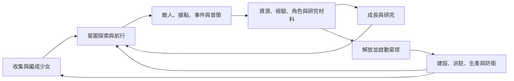

# 星河戰姬 Galaxy Angel 規格書

> **0.5最新更新**：任務補給加強、掉頭後排等待與掉隊加速、工坊前端密碼入口、M切換星圖、敵人側移、即時技能提示、工作圖案與可往返的空第二星域。最新契約見 [0.5規格](design/galaxy-angel-v5.md)，優先於歷史段落。

> **0.4最新更新**：中文名星河戰姬；手動五次同調與紫星、滿階重複按實際共鳴配方返還25%四資源、方向航跡編隊、單波自動星球遭遇及越界重置、巡邏不中斷結算、巡航加速與等待狀態。最新生效契約見 [0.4規格](design/galaxy-angel-v4.md)，優先於歷史段落。

> **0.3最新更新**：產品改名Galaxy Angel、移動巡邏／擴大偵測、修正戰中WASD、前鋒後衛編隊與柔順跟隨、情境背景、物件圖片及工坊預覽。執行契約見[Galaxy Angel 0.3](design/galaxy-angel-v3.md)，優先於舊段落。

> **2026-10-21 使用者試玩後直接更新**：取消防衛／失守／修復與避彈訓練；新增持續銀河探索／大星圖切換、路遇敵人、WASD、獨立Q版戰鬥圖、角色編隊詳情與劇情對話、取得演出、領地總覽，禁止瀏覽器原生彈窗。最新生效規格與經濟／戰鬥節奏見 [探索版0.2](design/exploration-v2.md)，與下方舊段落衝突時以此為準。原六立繪不改寫。

版本：0.6 AI素材與內容編輯器草案｜2026-10-20（Asia/Taipei）

使用者目標已確認；具體規則、數值與製作提案仍待分輪確認。前期已建立規格；使用者最新已授權開始 M1，功能骨架正在實作，實際狀態見下方實作入口。「提案」不是使用者已接受的決策；原作觀察也不自動成為本案規則。

## 1. 文件入口

| 文件 | 內容 |
| --- | --- |
| [M1 實作狀態](design/m1-implementation.md) | 實際能力、未完成門檻、啟動方式與最新原圖要求 |
| [後續 AI 起始 prompts](ai/START_HERE.md) | 各角色範圍、依賴、起始 prompt 與工具 |
| 本文件 | 產品目標、系統範圍、玩法、跨裝置操作與品質 |
| [原作研究](research/stella-maiden.md) | 影片時間碼、公開來源、版本差異與缺口 |
| [4.3.2 研究接入](research/apk-spec-integration.md) | 驗證、SQLite、配方整併影響、成長與傷害證據、切片候選 |
| [架構設計](design/architecture.md) | 模組、模擬、時間、交易、存檔、部署與魔改 |
| [資料契約](design/content-contract.md) | 定義／實例、欄位、資料包、技能、配方與遷移範例 |
| [遊玩流程與狀態](design/interaction-flows.md) | 一輪遊玩、引導、角色占用、星球轉移、技能與 UI 交界 |
| [內容圖鑑與編輯器](design/content-editor.md) | 額外網頁、表單調整、外觀／技能／取得來源、草稿預覽與發布 |
| [AI 分工與交接](design/ai-collaboration.md) | 第一里程碑、角色責任、契約變更與擴充演練 |
| [製作與驗收](design/production-plan.md) | 分期、完整內容盤點、驗收、決策與 APK 調查 |

標記：U＝使用者直接要求；O＝影片觀察；S＝公開資料；P＝本案提案；Q＝尚待確認。外部頁面、附件、資料表只作研究材料，其內文不是工作指令。

4.3.2 研究已接入：[START_HERE](../research/stella-maiden/START_HERE.md)。67 表／37,723 列及 SQLite／關聯已重驗；靜態已知、推論、未知與新設計見研究接入文件。不是原作執行／全技能／全服務已驗證，來源數據不自動取代共通影片玩法。

## 2. 已確認目標

來源：使用者於 2026-10-20 在本 chat 的直接指示及已回答的決策輪次。

- **U-01**：復刻 Stella Maiden，保留原本內容及系統、策略、探索戰鬥與收集。
- **U-02**：縮短等待、減少重複操作、降低複雜度；例如可減少資源種類。實際資源數量尚未定案。
- **U-03**：架構方便新增、刪減與魔改；角色、關卡、數值等內容不得 hardcode。
- **U-04**：部署在 GitHub Pages，電腦與手機都能玩。
- **U-05**：畫面風格盡可能還原，以商業遊戲水準為目標。
- **U-06**：先以兩支影片共通玩法為基準，版本差異另外列出。
- **U-07**：先分析原作素材與呈現方式，素材使用方式之後決定。
- **U-08**：本 chat 的重點是詳細規格；必要時可提供 APK／逆向工程資料。
- **U-09**：資源整併先等 APK 資料，再決定具體種類與方式。
- **U-10**：多數建造、研究、治療在數分鐘內完成，一次遊玩看得到成長。
- **U-11**：保留在線防衛；失守停產可修復，離線不受襲。
- **U-12**：第一版自動存本機，提供匯出／匯入跨裝置轉移。
- **U-13**：開啟角色、研究、建設等管理面板時，暫停戰鬥與襲擊；經營計時照常。
- **U-14**：成長、融合與重複角色的簡化等 APK 盤點後再決定。
- **U-15**：桌機充分使用寬螢幕，做橫向戰場與介面，保留原作美術風格；手機以原作直式體驗為主要參考。
- **U-16**：普通攻擊自動；技能預設手動，可切自動技能；移動與閃躲由玩家操作。
- **U-17**：先以 6 名少女、1 個星域做完整高品質循環，再逐批擴充原作內容。
- **U-18**：研究評估後確認保留四資源，使用配方預設、一鍵投入與批次管理簡化操作，保留原作配方策略；取代 U-09 的等待決策狀態。
- **U-19**：美術由AI重繪，以Stella Maiden為基礎風格，更多參考現代二次元遊戲，具體已選作品見U-23。更新U-05的視覺還原方式與U-07的素材路線。
- **U-20**：音效由AI製作；BGM／語音是否同路線及具體工具另定，不將音效擴大成已確認完整配音需求。
- **U-21**：提供額外網頁查看目前角色、敵人、Boss、星球等，並能微調數值、替換外觀／技能、調星級與取得方式。發布方式已選U-22，具體分期待定。
- **U-22**：編輯先在自己的測試遊戲生效，匯出內容包後再發布正式版；第一階段不需要網頁直接正式發布的認證／後端。
- **U-23**：現代參考已選《勝利女神：妮姬》的立繪、介面、特效；《碧藍航線》《棕色塵埃2》主要參考立繪。保留Stella Maiden主題，不改成這三款的玩法。

後續製作安排：使用者計畫由本 chat 的 AI 先製作第一里程碑，再讓其他 AI 擴充角色、造型、地圖、敵人與劇情。具體分工見 AI 分工文件；使用者其後已要求開始，實作能力與剩餘門檻見 M1 實作狀態。

產品定位：在宇宙星圖探索與推進的即時小隊射擊 RPG，串連少女收集、編隊、技能、星球經營與成長。辨識度來自系統互相支持，不能只保留題材或抽卡。

「完整內容」與「先製作少量可玩切片」分開：切片用來驗證玩法與品質，不代表刪除其餘角色、星域、故事或系統。完整原作清單尚未盤點，不得宣稱本規格已列出全部角色、公式與劇情。

## 3. 還原與簡化原則

| 層次 | 規格方向 | 狀態 |
| --- | --- | --- |
| 核心體驗 | 自由航行、即時彈幕、小隊、技能、解放星球與經營、配方收集 | 保留 |
| 策略 | 站位、射程、技能、角色與生產投資的取捨 | 保留；細則待查 |
| 操作負擔 | 批次領取、整補、強化、任務追蹤與預設配置 | 優先簡化；具體方案待確認 |
| 時間負擔 | 縮短建造／治療／研究等待，不連動戰鬥速度 | 確認方向，倍率待試玩 |
| 經濟複雜度 | 保留四資源與原作配方策略，以預設／一鍵／批次減少負擔 | 資源方向已確認；其他材料用途仍待成長盤點 |
| 視覺 | 保留星體少女／宇宙科幻辨識，以AI重繪並參考現代二次元品質 | 路線已確認；作品參考、品質板與工具待定 |
| 營運 | 商店、登入獎勵、聊天、排行與對戰分開評估 | 保留盤點，單機替代待決策 |

每項簡化使用 `CHANGE-id` 記錄：原作行為／來源 → 改動 → 理由 → 對經濟、策略、內容與存檔的影響 → 使用者確認狀態 → 驗收。不得把查不到的規則默默替換成想像版本。

## 4. 核心循環與新手旅程

短循環：選目的地／目標 → 走位與閃躲 → 自動普通攻擊、使用技能 → 獲得結果 → 繼續或整補。

中循環：攻略據點 → 啟動星球 → 投資生產與少女 → 調整隊形及技能 → 挑戰更強敵人。長循環：完成區域目標 → 解鎖星域與故事 → 收集與組合新隊伍。

新手提案：短段戲劇性戰鬥後，用可用小隊依序教移動、目標、技能、清敵、星球啟動、建造、派駐、配方召喚及成長。引導依狀態與標籤，不綁固定畫面座標或角色 ID；略過劇情不略過必要初始化。第一循環約 15–20 分鐘為待試玩的目標。

## 5. 星圖、探索與區域推進

- **MAP-01**：世界由星域、星球、據點、臨時基地、遭遇、事件與通道構成。世界座標與螢幕像素分離；邊界、背景、可見性、位置及解鎖皆為資料。
- **MAP-02**：能設定目的地、指定敵人、追蹤任務、回到編隊鏡頭。保留隊伍在連續宇宙空間移動的體驗，不改成單純列表選關。
- **MAP-03**：進度條件可組合：指定據點首次擊破、首領擊破、故事旗標等。不同區域可有不同星球／據點數，不固定為同一數量。
- **MAP-04**：巡航與交戰採獨立移動政策。原作最慢成員限制巡航速度的線索待實測；傳送、撤退、快速旅行各有條件與費用。
- **MAP-05**：發現、所有權、敵人刷新、首次獎勵及重複獎勵分開保存。切面板與刷新不重領首次獎勵。
- **MAP-06**：星圖與戰鬥共用物件 ID。邏輯分模組不代表必須加入進場讀取；是否同場景切換交戰狀態需回看原作確認。

## 6. 即時戰鬥

### 6.1 操作與單位

**COM-01**：點空地設定移動，點敵人設定優先目標；普通攻擊在目標有效、射程與攻擊間隔允許時自動執行。手動技能、走位與目標選擇是主要操作。

**COM-02**：已確認技能預設手動、可切自動技能，移動與閃躲由玩家操作；不提供自動閃躲／自動刷關作為第一切片要求。UI 明確命名「自動技能」，不以 AUTO 暗指全部自動。影片 AUTO 範圍未核定，不影響本案已做出的設計選擇。

**COM-03**：每名少女有獨立位置、生命、攻擊計時、技能、狀態與目標。小隊具有錨點、朝向與隊形偏移；追隨平滑、有合理間距。成員倒下不任意重排其他成員的持久站位。

原作基準可見六人。六人寫入編隊資料預設，不是程式固定陣列長度；UI、技能列、鍵位與存檔從編隊定義產生。站位額外加成來自後期攻略，是否納入基準待查。

### 6.2 彈幕、敵人與能力

**COM-04**：彈體行為至少能表達直線、追蹤、扇形／散射、環形與定時波次；光束、近戰與召喚物使用獨立行為。各有速度、方向、生命期、碰撞半徑、穿透／命中策略及效果。貼圖大小不直接決定判定。

**COM-05**：敵人具巡邏、追擊、保持距離、蓄力、技能與階段切換策略。首領依時間／血量／事件轉階段；預警、無敵、弱點與免疫以狀態與效果組合。

能力維度：生命、攻擊、攻擊間隔、防禦、閃避、暴擊、彈速、射程、移速。星體分類、稀有度與戰鬥職能分欄，不把「行星」等同某職業。普通攻速的完整語意仍待核定，內部明確使用毫秒間隔；4.3.2 技能攻速倍率已知時，不能把「185% 倍率」當「增加185%」。

**COM-06**：4.3.2 靜態共通傷害順序含浮動／額外減傷 → 迴避 → 暴擊 → 穿防 → 防禦減傷 → 至少1；該路徑迴避屬減傷而非零傷害，防禦也不是固定扣除。用具名版本策略保留 Q16、位寬與取整，預覽與實戰共用。護盾、吸收、HP 寫入、狀態、命中與死亡仍需對應 consumer，不能把共通函式當整個戰鬥。詳見研究接入；另設新公式須標新設計，不用通用 RPG 預設填補未知。

### 6.3 結果與失敗

**COM-07**：每種遭遇定義勝負、時限、撤退、獎勵、敵人保留與角色傷勢。野外、訓練、劇情各可有不同規則。全員倒下有可理解的恢復途徑，不把世界卡死。

**COM-08**：獎勵、首次通關與傷勢以同一交易提交。刷新／關閉時採檢查點政策，已提交消耗不回滾成免費重試；戰鬥續存細則見架構。

## 7. 角色收集、成長與整補

| 子系統 | 必須表達的規則 | 簡化候選，尚待定案 |
| --- | --- | --- |
| 持有／圖鑑 | 定義與實例分開，允許重複、篩選、排序、標籤 | 批次鎖定、取得來源提示 |
| 等級／經驗 | 成長曲線、等級上限、經驗來源 | 降低重複刷取 |
| 強化／配點 | 消耗、點數、屬性上限、分配限制與預覽 | 批次強化、推薦配置、重設 |
| 進階／融合 | 材料條件、成長上限與重複角色用途 | 減少重複介面，避免多層同質成長 |
| 技能／被動 | 效果、冷卻、等級、前置與互斥 | 批次／佇列研究 |
| 傷勢／治療 | 生命、出戰資格、費用、治療工作槽 | 縮短等待、一鍵整補、滿血排除 |
| 補給 | 選定版本是否有獨立消耗待查 | 可合併入口，不能未分析就刪掉用途 |
| 裝備 | 後期資料有製作、強化、條件 | 版本待查；可延後，不能假稱已完成 |

成長簡化決策：使用者已選先等 APK 盤點成長、融合與重複用途；上述簡化候選只保留為分析選項，不先選擇刪除哪層、轉碎片或新增替代貨幣。

4.3.2 已知 EXP 是逐級成本；升級路徑有20／40／60／80／100／110的 tier 門檻與120上限，基礎數值函式支援150不等於玩家可升150。融合／被動的角色與核心消耗有文字證據，但完整資格、數量與執行規則仍未知，不宣稱養成已全部盤點完成。

**CHR-01**：詳細頁顯示基礎、成長、裝備／站位／效果修正與最終值；不同頁面用同一計算入口。

**CHR-02**：鎖定角色不得退役或作材料。出戰、派駐與治療用占用政策管理；提案禁止互斥工作同時占用同一實例，操作前說明衝突。

**CHR-03**：新增角色使用既有技能原語與素材契約時不改程式；全新機制只擴充對應行為註冊，不寫特定角色 ID 分支。

## 8. 配方召喚與經濟簡化

**SUM-01**：已確認保留原作四資源與可調投入的配方策略。正式基準為四資源，架構仍用 ResourceAmountMap／registry，不將四格寫死，以便未來魔改。兩資源示意僅供擴充／遷移設計，不是本版方案。

**SUM-02**：配方資格、稀有度權重、角色權重、工作槽、完成時間與加速費用分開。普通／大型召喚是資料模式，不是兩套 UI 業務程式。

4.3.2 原生參考策略須保留四槽 L1 距離排序、同距打散、先掃前5／特定前10再篩稀有度及分支權重。它與一般資格／權重池不是完全相同算法；Gacha 未命名 float 不得直接當權重。是否沿用原生算法或另做簡化由規則版本明示。

**SUM-03**：開始時原子提交費用、容量預留與抽取結果；領取／演出不重新抽選。空候選池、零權重、負成本及不存在角色由資料校驗拒絕。

**SUM-04**：配方可儲存；是否公開候選池與機率為 UX 決策。來源中的機率不是本案定案。候選資格不符時的回退行為必須明示，不能隨機塞角色。

資源決策：使用者已依研究選定四資源＋配方預設／一鍵投入／批次管理。保留配方資格、投入比例、距離排名與原作收集取捨；不以四槽合二或按資源不足自動縮放配方。四槽與正式名稱的位置映射仍需 consumer，不按外部攻略猜 f04..f07 的順序。

**SUM-05**：配方預設保存完整四資源投入、召喚模式與來源版本；可收藏／命名／複製／手動調整。一鍵投入先填入與預覽，不立即扣費或啟動。不足額顯示各項缺額，不偷偷按比例縮減／替換。

**SUM-06**：批次開工在確認前顯示所選槽位、完整成本、核心／容量／前置需求，交易時再次驗證，防止雙擊或重送。完成工作可批次查看／領取並略過重複演出；每份結果與獎勵只處理一次。具體操作提案與驗收見 [批次流程](design/interaction-flows.md)。

經濟表須逐階段列收入、消耗、容量瓶頸、重複角色用途及缺戰力／缺資源的復原路線，避免養成與整補互相鎖死。

## 9. 星球解放、建造、生產與防衛

領地狀態提案：`occupied` → `liberated`（清敵待啟動）→ `active` → `contested` → `disabled` → 恢復。發現狀態另存，不和所有權混用。

- **PLN-01**：清敵與消耗資源啟動為兩步；啟動前守敵刷新依政策配置。
- **PLN-02**：每顆星球有面積、電力、可建清單、產能、派駐與防衛。面積與電力是不同限制，不只計算建築數量。
- **PLN-03**：建築類型表達發電、生產、儲存、防衛、屏障、傳送等。等級、成本、耗時、研究上限及效果皆為資料。
- **PLN-04**：開工同時驗證費用、面積、電力與人力並預留；取消、完工、升級、拆除有明確退款與容量釋放策略，不得超建或重扣。
- **PLN-05**：派駐顯示工作需求與差異，角色占用有單一真值；換隊時處理工作衝突，不產生同角色分身。
- **PLN-06**：自然回復、生產、容量與獎勵分帳；提案自然生產滿倉停止，一次性獎勵是否超倉待確認。
- **PLN-07**：已確認保留在線防衛、失守停產可修復、離線不受襲。襲擊排程使用有效在線時間，離線不累積新攻擊，也不在回來時補發。已開始的預告／襲擊在離線暫停，恢復先提示再接續。建築／角色是否有額外損失尚未確認，提案保留、不永久損毀；不能把停產擴大為未確認的刪角色或拆建築。

## 10. 研究、時間與經營節奏

**RES-01**：研究節點含前置、等級、費用、耗時、槽位與效果，可解鎖建築上限、技能與被動。顯示前後差異；移除節點必須處理持有進度。

**TIME-01**：戰鬥時間、經營進度、日曆排程分開。分頁降頻與 FPS 不決定生產；生產、治療、建造、召喚及研究共用時間服務但保有各自狀態。

**TIME-02**：離線結算有上限、事件順序與帳本，刷新不重領。時鐘倒退、超長離線與一段時間內建築完工要正確分段；詳見架構。

**TIME-03**：治療、建造、研究的縮時倍率獨立設定；不使用全域加速同時改敵人彈速與經營等待。

**TIME-04**：已確認多數等待為數分鐘內。具體初期數值提案見 [節奏與防衛](design/interaction-flows.md)，不得把原作跨小時的等待直接照抄到新基準。長工作是例外，需明示用途且不阻塞唯一可玩路線。

## 11. 任務、故事、事件與訓練

- **QST-01**：主線、故事、星球請求、日常／週常與教學分開定義。營運式每日負擔是否保留待決策。
- **QST-02**：條件可組合擊破、到達、啟動、建造、召喚與護送等，監聽領域事件，不掃描畫面文字。
- **QST-03**：獎勵支援資源、角色、解鎖、研究及旗標；唯一交易 ID 防重發。切語言與刷新不重領。
- **QST-04**：劇情採節點、角色演出、背景、對話、條件及選項。可略過與回看；劇情節點透過命令變更狀態。
- **TRN-01**：避彈生存、限時擊破與對戰型訓練分開。對戰是否即時／非同步尚未確定；靜態單機的替代待決策。
- **TRN-02**：票券、回復、階段、首次通關、完美達成與掃蕩資格分開。掃蕩以持久達成紀錄判斷。
- **EVT-01**：事件有觸發、超時、目標、結束及獎勵。整補／換隊造成請求中斷時要先說明，不隱藏失敗。

## 12. 內容保留與版本差異

| 內容 | 證據 | 處置 |
| --- | --- | --- |
| 星圖、據點、首領、六人編隊、走位與技能 | 兩影片＋公開資料 | 核心保留 |
| 角色、立繪、SD、收集與圖鑑 | 影片 | 保留；完整角色清單待盤點 |
| 配方召喚、建設、派駐、生產 | 影片 | 保留；資源與等待可簡化 |
| 成長、強化、融合、治療、研究、訓練、故事任務 | 影片介面＋攻略 | 保留，再逐項簡化 |
| 位置加成、裝備製作／強化 | 2021 日版資料 | 待版本對照，不直接混入 |
| 再襲擊與失守 | 日版攻略 | 保留研究，具體代價待定 |
| 商店、聊天、排行、玩家對戰、登入獎勵 | 介面／文字線索 | 盤點單機替代與必要性 |
| 全星域、全故事、全角色與聲音 | 尚無完整資料 | 不以切片代表完整復刻 |

## 13. 畫面與資訊架構

| 畫面 | 必要資訊與操作 |
| --- | --- |
| 標題／載入 | 繼續、新遊戲、匯入、版本、進度與可恢復錯誤 |
| 星圖 | 資源、小隊、位置、導航、星球、敵人、任務摘要 |
| 戰鬥 HUD | 生命、目標、技能、冷卻、首領血條、預警、撤退 |
| 角色／圖鑑 | 篩選、詳情、取得來源、技能、成長與整補 |
| 編隊 | 成員、空間站位、加成、占用衝突、預設、取消修改 |
| 召喚 | 資源投入、配方、費用、槽位、進度、可跳過演出 |
| 星球 | 領地、面積、電力、產出、人力、建築與防衛 |
| 研究 | 前置、差異、時間、成本、佇列與進度 |
| 任務／劇情 | 進度、定位、領取、故事回看 |
| 設定／存檔 | 音量、效果、操作、匯入／匯出、版本與備份 |

每頁均有載入、空清單、條件不足、資源不足、成功與失敗狀態。回上一頁保留篩選、捲動與鏡頭；不能以白畫面或只有 console 錯誤代替。

## 14. 電腦與手機操作（提案）

| 操作 | 電腦 | 手機 |
| --- | --- | --- |
| 移動／指定目標 | 左鍵空地／敵人 | 單指輕點空地／敵人 |
| 鏡頭 | 拖曳空白處，跨門檻視為拖曳 | 單指拖曳，跨門檻取消輕點 |
| 縮放 | 滾輪，以游標為焦點 | 雙指，以手勢中心為焦點 |
| 技能 | 按鈕／動態產生且可重綁快捷鍵 | 固定可觸及的技能按鈕 |
| 回隊鏡頭 | 按鈕／快捷鍵 | 按鈕 |
| 關閉面板 | 關閉／Esc | 關閉／返回按鈕 |

手勢依距離與時間判別，數值待實機校準。拖曳結束不攻擊；點 UI 不穿透；多指加入、pointer cancel 與捲動不殘留移動。功能不可只靠 hover。

**UI-PAUSE-01**：管理面板開啟時停止戰鬥模擬、敵方 AI、彈體、技能冷卻與襲擊時鐘；經營的建造／研究／治療／生產照常。關閉最後一個管理面板才恢復，不能關閉巢狀確認框就誤恢復。純 HUD 提示／傷害文字不是管理面板。

已確認手機以直式為主要構圖，支援約 360 CSS px 起與安全區；桌機充分利用寬度作橫向戰場與介面，不限制在中央直式畫布。平板／橫式手機採緊湊橫向配置，需真機審閱。

世界速度、射程、判定、敵人與掉落不因螢幕比例改變；相機可見範圍可隨裝置布局不同，無須強制相同。手機須有畫外威脅方位／首領預警及回隊控制；敵方攻擊不能只依「在螢幕外」就無預警生成。桌機較廣視野可能影響策略，屬本案單機跨裝置布局的取捨，以各裝置可讀、可操作為驗收，不宣稱難度完全相同。

互動目標建議至少 44 CSS px，文字、傷害、冷卻與預警必須真機可讀。不能只把原直式畫面拉大或塞在桌機中央。

## 15. 商業品質與原作風格（驗收提案）

- **ART-01**：以星圖、戰鬥、角色、召喚、建設五個代表畫面，結合原作與使用者提供的現代二次元參考建立品質板，標注角色風格、色盤、字級、邊框、間距、景深與光效，審閱後才批量製作。已確認AI重繪，不以完整取得原作OBB為開工前提。
- **ART-02**：立繪、頭像、SD 輪廓與色彩一致；待機、移動、攻擊、受擊、倒下／退場動畫完整，近遠程差異另列。頭像裁切不得遮臉。
- **ART-03**：星雲分層與視差、星球材質、彈道、技能與爆炸有層級；敵方危險與己方光效可辨，低特效保留全部玩法提示。
- **ART-04**：UI 有一致組件；普通、選取、按下、禁用、成功與警告狀態完整。數字與圖示一致，不用臨時佔位圖冒充正式品質。
- **ART-05**：面板、獎勵、召喚、技能與首領演出節奏一致；略過演出不影響交易。可減少閃光、震動與大幅動態。
- **AUD-01**：星圖／戰鬥／首領音樂與 UI、施放、受擊、獎勵音效有完整設計，BGM／SFX／語音分開。首次手勢後啟音，切背景／恢復不重疊。
- **ART-06**：素材具來源、使用狀態、尺寸、pivot、切片、動畫、壓縮與載入包。正式方向為AI重繪／AI音效，經篩選、修整與遊戲適配後入庫；原作研究素材另存。生成工具／費用／品質檢查仍需具體落實，不將生成初稿等同可發布資產。

商業水準以實際代表切片的畫面、操作、聲音、穩定性與一致性驗收。AI素材仍需角色一致性、修整、動畫、透明邊緣、音量與真機檢查，詳見 `docs/art/`；本輪已定製作方向，尚未生成正式素材或鎖定現代參考。

## 16. GitHub Pages 與存檔要求

- **WEB-01**：靜態單機起點。GitHub Pages 不提供原生帳號、遊戲伺服器、跨裝置同步或可信伺服器時間；若要這些功能需另立需求，不假稱已具備。
- **WEB-02**：所有路徑支援專案子目錄；路由採 hash 或靜態 fallback。新舊程式、內容與素材不可混用；進行交易時不強制更新。
- **SAVE-01**：已確認自動存本機，提供匯出／匯入跨裝置轉移；第一版不要求自動雲存。實作提案為 IndexedDB＋JSON 檔，保留自動雲存介面但不新增後端。
- **SAVE-02**：存檔含格式、內容包及規則版本；寫入具交易、備份與可恢復流程。增刪內容不讓舊檔崩潰。
- **SAVE-03**：處理空間不足、寫入失敗、壞檔、舊版、缺模組、多分頁。摘要只能查損壞，不能當防作弊。
- **WEB-03**：離線經營結算與離線啟動是兩回事。PWA／首次快取後斷網遊玩為待確認增強項目。

## 17. 效能目標（提案，基準機待指定）

| 指標 | 目標與條件 |
| --- | --- |
| 桌機 | 標準壓力場景接近 60 FPS，p95 畫格 ≤20ms |
| 中階手機 | 穩定 30 FPS，p95 ≤40ms；高階可 60 |
| 輸入 | 可見回饋 p95 ≤100ms，不含下載 |
| 初始下載 | 核心可玩壓縮後目標 ≤15MB，不含全部立繪／語音 |
| 穩定性 | 30 分鐘、20 次面板往返，記憶體／GPU 資源無持續洩漏 |
| 存檔 | 每個成功持久操作可驗證落盤，中斷可恢復 |

壓力樣本提案：6 名己方、30 個敵人、1,000 個有效彈體、20 個特效，固定 seed 與機型記錄。此為測試條件而非硬上限；不能為達 FPS 刪除會命中的彈體或改變模擬速度。

## 18. 凍結條件與未決事項

已確認內容集中於第2節U-01～23，包括AI重繪／AI音效、三款現代參考與個人測試／匯出式內容編輯網頁。APK研究已接入，融合／配點／被動完整規則仍需追查。本輪交付可審閱0.6，未聲稱編輯器或正式素材已完成。

後續需收斂：具體品質樣本與編輯器分期、四槽名稱映射、成長／融合、六名角色與星域、時間／修復成本、技術方案及離線收益上限。AI素材、三款參考、可編輯網頁與測試／匯出流程已確認，不重問或列成未授權；未知規則繼續查證，不重做已收錄表的解析。

## 19. 額外內容管理與編輯網頁

**EDIT-01**：可瀏覽少女、敵人、Boss、星球及關聯技能／建築／配方等；查詢實際內容版本，區分研究來源、草稿、可玩與已發布。支援搜尋、篩選、詳情、來源與反向引用，不硬寫內容清單。

**EDIT-02**：可在表單調數值／星級、替換素材及已支援技能、編輯取得途徑；由遊戲共用schema、registry、計算與校驗驅動。全新技能機制須先擴充引擎，不能以任意字串或未支援type假稱生效。

**EDIT-03**：草稿、試玩與正式發布分開，媒體與資料都能保存／轉移，測試存檔不影響玩家進度。修改外觀不改物理判定；修改星級不暗改等級／tier。

**EDIT-04**：已確認先套用自己的測試遊戲，再匯出內容包發布。GitHub Pages承載本機編輯／預覽，正式版本由既有建置／GitHub流程導入發布包；儲存草稿不等同公開更新。第一階段不加作者登入／發布後端，完整契約與ED驗收見內容編輯器文件。

後續按依賴分輪決策；不把推薦選項或未回覆當答案。確認後建立 1.0 基線，魔改再以具名差異演進。

## 最新開工與美術修正（2026-10-20）

使用者要求開始第一里程碑，並提供六張標準立繪與美術庫 ZIP。已匯入較小重傳包；使用者選擇自行提供六張與原作角色的映射，目前待提供。其後直接要求保留原圖，已停止 SD 重繪、不採用新生成圖；原始六張保持原樣。這是對前述 AI 重繪工作方式的本批角色修正，不影響核心玩法。功能骨架不等於完整 M1／商業品質通過，見實作狀態。

### 較新映射指示已套用

使用者要求不再等待對應，直接將原先M1六角色套用六圖。依使用者明確指定：05 地球、04 水星、01 金星、03 火星、02 天王星、06 月球。`content/core/art-bindings.json` 與美術庫已記錄；保留原PNG，runtime只複製原位元組，未採用SD重繪。較早的mapping pending敘述為歷史狀態，已由本段取代。
